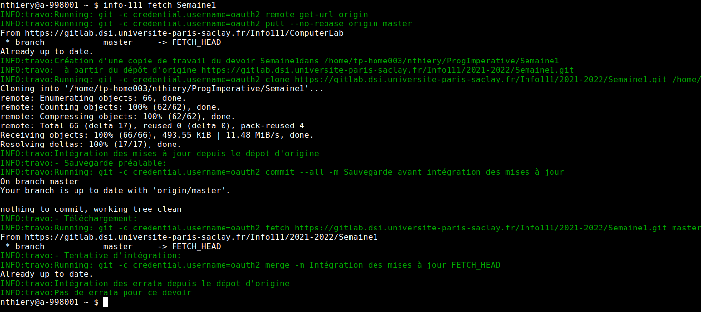

---
jupytext:
  text_representation:
    extension: .md
    format_name: myst
    format_version: 0.13
    jupytext_version: 1.10.3
kernelspec:
  display_name: C++17
  language: C++17
  name: xcpp17
---

# Semaine 1: Introduction à l'informatique et premiers programmes

## [Cours](http://nicolas.thiery.name/Enseignement/Info111/Cours/Cours-1-Introduction.pdf)

## <a href="TD.pdf">TD</a>

## TP: prise en main, premiers programmes avec laby

+++

**Tout exercice non marqué d'un $\clubsuit$ est à terminer pour la semaine prochaine.**

+++

### Introduction

Dans ce premier TP vous allez écrire de petits programmes de façon
ludique (faire sortir une fourmi d'un labyrinthe, etc), occasion d'avoir
un premier contact avec quelques constructions (conditionnelles,
boucles, fonctions) que nous approfondirons par la suite.

Pour cela, nous utiliserons des *feuilles d'exercices interactives
`Jupyter`*. `Jupyter` est une application web qui permet de programmer
interactivement dans de nombreux langages (`Python`, `C++`, ...), un
peu comme une super calculatrice, et de rédiger des documents
interactifs.

Pour travailler sur ces feuilles d'exercices, vous avez deux options:

-   travailler **sous Linux en salles de TP** du bâtiment 336

-   ou utiliser le **service JupyterHub@Paris-Saclay** de l'université:
    <https://jupyterhub.ijclab.in2p3.fr/>, depuis tout ordinateur ou
    tablette connectée à Internet.

Les instructions ci-dessous diffèrent un peu selon l'option choisie:
**ne faites que celles correspondant à votre option**. En salle de TP,
la première option est à privilégier afin d'éviter de trop charger le
service.

Chaque semaine, vous téléchargerez un répertoire contenant les sujets de
TD et TP accompagnés de fichiers de travail. En semaine 1, ce sera le
repertoire `Semaine1` qui ira dans le répertoire
`~/ProgImperative/Semaine1`.

Vous **déposerez** ensuite régulièrement votre travail. Ce dépôt aura
pour effet de sauvegarder votre travail sur la **forge logicielle
GitLab** de l'université, et de le rendre ainsi accessible depuis chez
vous. Cela permettra aussi à vos enseignants de se faire une idée de
l'avancement général du groupe. Plus tard dans le semestre, le dépôt
vous permettra d'obtenir un retour automatique sur votre travail, et
pourra servir pour des TP notés (vous serez prévenu à l'avance).

Pour interagir efficacement avec le système -- manipuler des fichiers,
lancer des programmes, télécharger et déposer les TP , etc -- vous
allez apprendre cette année, et notamment dans l'autre cours
«Introduction à l'Informatique», à utiliser le *Terminal* à la place
du gestionnaire de fichiers; taper des commandes plutôt que cliquer à
la souris. Pour aujourd'hui, vous allez voir juste le strict
nécessaire. La magie sera expliquée plus tard.

### Exercice: Activer votre compte GitLab

1.  Si ce n'est déjà fait, activez votre compte GitLab en vous
    connectant une première fois sur
    <https://gitlab.dsi.universite-paris-saclay.fr/> avec vos
    identifiants et mots de passe de l'université (Adonis). Veillez
    ici et dans tout le reste de cette feuille à utiliser vos
    identifiants longs de la forme `prenom.nom`.

2.  Si vous avez pu vous connecter, c'est tout bon, vous pouvez vous déconnecter.
    Si non, prévenez votre enseignant.

+++

### Exercice: Se connecter, ouvrir un terminal

Rappel: ne faire que l'une des deux options ci-dessous.

**Option 1: en salle de TP sous Linux**:

1.  Démarrer votre ordinateur en choisissant **Linux** ou **Ubuntu** et non
    **Windows** lorsque cela est demandé au démarrage.

2.  Lancez un terminal. Pour cela vous pouvez utiliser le menu principal
    (bouton en bas à gauche) et cliquer sur «terminal».

**Option 2: avec JupyterHub@Paris-Saclay**:

1.  Connectez vous au service
    [JupyterHub@Paris-Saclay](https://jupyterhub.ijclab.in2p3.fr/).
    Dans la boîte de sélection d'établissement, tapez `Saclay` puis
    sélectionnez `Université Paris-Saclay`. Utilisez votre identifiant
    prenom.nom et mot de passe de l'université (Adonis).

    Vous arrivez à un écran `Start My Server`; cliquez dessus pour
    démarrer votre serveur `Jupyter` personnel.

    Vous obtenez un navigateur sur les fichiers de votre répertoire
    personnel sur ce serveur. Notez que ce répertoire est indépendant de
    votre répertoire personnel dans les salles de TP. Aussi, si c'est la
    première fois que vous utilisez ce service
    JupyterHub, ce répertoire est vide.

2.  Lancez un terminal **sur le service JupyterHub** avec le menu
    `New -> Terminal` (à droite).

+++

### Exercice: Téléchargement des feuilles d'exercices

:::{note}
Pour les redoublants: pour éviter toute confusion, déplacez au
préalable votre travail de l'an dernier:

    mkdir 2020-2021
	mv ProgImperative 2020-2021
:::

+++

Après avoir cliqué dans le terminal, tapez les commandes suivantes,
en validant avec `Entrée` après chacune d'entre elles.
Attention: ces commandes doivent être tapées avec le plus
grand soin: les majuscules, les espaces, les symboles sont tous
importants.

1.  Téléchargez les feuilles d'exercices:

		info-111 fetch Semaine1

    La première fois que vous faites cette commande, une
    authentification vous est demandée. Tapez les mêmes identifiants
    que ceux que vous avez utilisés pour activer votre compte GitLab
    au premier exercice. Il est normal que rien ne s'affiche quand
    vous tapez votre mot de passe. Tapez-le simplement en entier puis
    appuyez sur entrée.

2.  Votre terminal devrait ressembler à ceci:

	

3.  Les feuilles d'exercices ont été téléchargées dans le répertoire
    `ProgImperative/Semaine1` de votre répertoire personnel. Vous
    pouvez le vérifier avec la commande:

        ls ~/ProgImperative/Semaine1

+++

### Exercice: Démarrer Jupyter

Rappel: ne faire que l'une des deux options ci-dessous.

**Option 1: en salle de TP sous Linux**.

1.  Ouvrez un nouveau terminal.

2.  Tapez la commande:

		info-111 jupyter notebook

3.  Cette application ouvre une fenêtre dans votre navigateur web avec
    un navigateur de fichiers.

4.  Attention: le terminal qui vous a permis de lancer Jupyter doit
    rester ouvert pendant toute votre utilisation de Jupyter! Le mieux
    est de le minimiser (sans le fermer). Si vous avez à nouveau besoin
    du terminal par la suite, il faudra ouvrir un autre terminal.

**Option 2: avec JupyterHub**:

Jupyter est déjà lancé. Si vous êtes sur le terminal, vous avez juste
à revenir sur le navigateur de fichier, par exemple en revenant dans
votre onglet précédent si vous ne l'avez pas fermé (ou sinon en cliquant
sur "Jupyter").

+++

### Exercice: Premier pas avec Jupyter

1.  Naviguez jusqu'au sous répertoire `Semaine1` de
    `ProgImperative` et sélectionnez la feuille de travail
    `0a-prise-en-main-jupyter.md`.

2.  Suivez les instructions qu'elle contient.

3.  Fermez la feuille en utilisant le menu
    `Fichier -> Créer une nouvelle sauvegarde`
    (`File-> Save and checkpoint`) puis
    `Fichier -> Fermer et arrêter`
    (`File -> Close and Halt`).

+++

### Exercice: Dépôt de votre travail

+++

1.  Dans un terminal, consultez la documentation de la commande `info-111`;
    Pour cela, tapez la commande
	
		info-111

2.  Retrouvez dans cette documentation les commandes pour télécharger 
    et déposer un TP, ainsi que la liste des groupes de TD.

3.  Déposez votre travail à l'aide de la commande indiquée dans la
    documentation que vous venez de lire. Veillez à mettre le bon
    groupe!

	<!--
    **Astuce: Complétion automatique**: pour aller plus vite, au lieu de
    taper le nom d'un fichier ou répertoire en entier, vous pouvez
    indiquer le début du nom et essayer de le compléter avec la touche
    `Tab` (tabulation, à gauche de la touche A). Si plusieurs fins sont
    possibles elles vous seront proposées. Ici, pour `ProgImperative`,
    tapez `Pro` puis la touche `Tab`.
	!-->

2.  Une fois votre travail déposé, ouvrez l'adresse affichée
    (suivant votre configuration, Clic simple, ou Clic-droit, Ouvrir le lien)
    pour consulter ce que vous avez
    déposé sur GitLab. Votre travail est maintenant sauvegardé et vous
    pouvez y accéder depuis chez vous.

Pensez à déposer régulièrement votre travail, et systématiquement à la
fin du TP pour que tout ce que vous avez fait soit bien sauvegardé.

+++

### Exercice: Premiers programmes en jouant

Le jeu [`laby`](https://sgimenez.github.io/laby/) propose plusieurs défis successifs; pour chacun
d'entre eux, le but est de guider pas-à-pas une fourmi vers la sortie
d'un labyrinthe à l'aide d'un programme. Chacun de ces défis sera
l'occasion de découvrir ou manipuler un concept de programmation.

<!--

- [Laby 1a](1a.md)
- [Laby 1b: Oh le caillou](1b.md)
- [Laby 1c: Encore un caillou!](1c.md)
- [Laby 2a: Que c'est loin ...](2a.md)
- [Laby 2b: Le couloir des cailloux](2b.md)
- [Laby 2c: Zig-Zag](2c.md)
- [Laby 3a: Ahhh des toiles!](3a.md)
- [Laby 3b: Toiles et cailloux](3b.md)
- [Laby 4a: La spirale infernale](4a.md)
- [Laby 4b: Par où passer?](4b.md)
- [Laby: Counting the rocks](counting-the-rocks.md)
- [Laby: C'est fou!](this-is-crazy.md)
- [Chou, chèvre, loup)[chou-chevre-loup.md]
- [Les Cruches](cruches.md)
!-->

Nous allons utiliser
[`laby-jupyter`](https://github.com/nthiery/laby-jupyter/) une
réimplantation de laby dans Jupyter.

1.  Relancez Jupyter si vous l'avez fermé (voir exercice précédent) et
    naviguer jusqu'à `Semaine1/`.

2.  Chaque feuille de `0b.md` jusqu'à `4b.md` correspond à un
    défi. Ouvrez les tour-à-tour dans l'ordre et suivez les
    instructions incluses. Déposez votre travail après chaque fiche.

3.  Résoudre en Python la feuille `chou-chevre-loup.md`.

4.  $\clubsuit$ Dans l'ordre que vous souhaiterez:

    - Reprendre en Python tout ou partie des défis de laby: `laby-python-*.md`.
    - Résoudre en Python le jeu des cruches.
    - Faire les feuilles laby supplémentaires `counting-the-rocks.md` et `this-is-crazy.md`.

+++

### Exercice: À faire pour la semaine prochaine

Deux heures supplémentaires de `Laby`! Vous pouvez par exemple
utiliser un ordinateur en salle libre-service de l'université (salle
215, sauf si cours) ou le service JupyterHub. Dans tous les cas,
continuez de déposez régulièrement votre travail. En particulier, le
déposer avant de vous déconnecter pour que tout ce que vous avez fait
soit bien sauvegardé.
