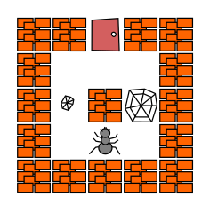
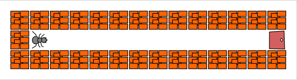

---
jupytext:
  notebook_metadata_filter: rise
  text_representation:
    extension: .md
    format_name: myst
    format_version: 0.13
    jupytext_version: 1.10.3
kernelspec:
  display_name: C++14
  language: C++14
  name: xcpp14
rise:
  auto_select: first
  autolaunch: false
  centered: false
  controls: false
  enable_chalkboard: true
  height: 100%
  margin: 0
  maxScale: 1
  minScale: 1
  scroll: true
  slideNumber: true
  start_slideshow_at: selected
  transition: none
  width: 90%
---

+++ {"slideshow": {"slide_type": "slide"}}

# Premiers éléments de programmation impérative

+++ {"slideshow": {"slide_type": "slide"}}

## Prélude

+++ {"slideshow": {"slide_type": "subslide"}}

### Résumé des épisodes précédents ...

-   Info 111: modalités et infrastructure

+++ {"slideshow": {"slide_type": "fragment"}}

-   Informatique: Usage, Technologie, Science

+++ {"slideshow": {"slide_type": "fragment"}}

-   Objectif d'Info 111: initier à la science via la technologie

+++ {"slideshow": {"slide_type": "fragment"}}

-   Concrètement: bases de la programmation impérative + ...

+++ {"slideshow": {"slide_type": "subslide"}}

## Rappel

**Programme**: suite d'instructions exécutées de manière séquentielle
(les unes après les autres)

+++ {"slideshow": {"slide_type": "fragment"}}

**Exemple:**

    debut();
    droite();
    avance();
    prend();
    gauche();
    avance();
    pose();
    droite();
    avance();
    gauche();
    avance();
    avance();
    droite();
    ouvre();

+++ {"slideshow": {"slide_type": "subslide"}}

## Comment rompre la monotonie?

+++ {"slideshow": {"slide_type": "fragment"}}

-   Faire des calculs: *expressions et variables*

+++ {"slideshow": {"slide_type": "fragment"}}

-   Découper en petits programmes: les *fonctions*

+++ {"slideshow": {"slide_type": "fragment"}}

-   S'adapter au contexte: les *instructions conditionnelles*

+++ {"slideshow": {"slide_type": "fragment"}}

-   Répéter: les *instructions itératives* (boucles)

+++ {"slideshow": {"slide_type": "slide"}}

## Expressions

+++ {"slideshow": {"slide_type": "fragment"}}

**Expression:** Combinaison de *valeurs* par des *opérations* donnant
une nouvelle *valeur*

+++ {"slideshow": {"slide_type": "fragment"}}

**Exemple**: L'expression `3 * (1 + 3) + (1 + 4) * (2 + 4)` vaut `42`

+++ {"slideshow": {"slide_type": "fragment"}}

**Opérations sur les entiers:**

|          opération           |    exemple    | résultat
|------------------------------|-------------- |---------
|            opposé            |   `-(-5)`     |   5
|           addition           |   `17 + 5`    |   22
|         soustraction         |   `17 - 5`    |   12
|        multiplication        |   `17 * 5`    |   85
|       division entière       |  `17 / 5`     |   3
| reste de la division entière |   `17 % 5`    |   2

+++ {"slideshow": {"slide_type": "subslide"}}

### Aparté: *syntaxe*, *sémantique*, *algorithme*

-   **Syntaxe**: comment on l'écrit

-   **Sémantique**: ce que cela fait

-   **Algorithme**: comment c'est fait

+++ {"slideshow": {"slide_type": "fragment"}}

**Exemple:**

-   Syntaxe: 17 / 5

-   Sémantique: calcule la division entière de 17 par 5

-   Algorithme: division euclidienne

+++ {"slideshow": {"slide_type": "subslide"}}

### Expressions booléennes

**Définition:**

Une expression dont la valeur est «vrai» ou «faux» (type: `bool`)

+++ {"slideshow": {"slide_type": "fragment"}}

**Exemples**:

```{code-cell}
---
slideshow:
  slide_type: fragment
---
true
```

```{code-cell}
---
slideshow:
  slide_type: fragment
---
false
```

+++ {"slideshow": {"slide_type": "fragment"}}

- `regarde() == Vide`
- `x > 3.14`
- `2 <= n  and  n <= 5`

+++ {"slideshow": {"slide_type": "fragment"}}

**Opérations booléennes usuelles:**

|        opération       |     exemple        |résultat
|  --------------------- |:-----------------:|----------
|       comparaison      |     `3 <= 5`       | `True`
|   comparaison stricte  |      `3 < 5`       |`True`
|   comparaison stricte  |      `3 > 5`       |`False`
|         égalité        |     `3 == 5`       |`False`
|        inégalité       |     `3 != 5`       |`True`
|        négation        |   `not 3 <= 5`     |`False`
|           et           | `3 < 5 and 3 > 5`  |`False`
|           ou           | `3 < 5 or  3 > 5`  |`True`

+++ {"slideshow": {"slide_type": "slide"}}

## Variables

+++ {"slideshow": {"slide_type": "fragment"}}

### Exemple

Calculer l'énergie cinétique $\frac12 m v^2$ d'un objet de masse $14,5$
kg selon qu'il aille à $1$, $10$, $100$, ou $1000$ m/s.

```{code-cell}
---
slideshow:
  slide_type: fragment
---
float v;
float m;
```

```{code-cell}
---
slideshow:
  slide_type: fragment
---
v = 100;
m = 14.5
```

```{code-cell}
---
slideshow:
  slide_type: fragment
---
1.0/2.0 * m * v * v
```

+++ {"slideshow": {"slide_type": "subslide"}}

### Définition

Une **variable** est un espace de stockage *nommé* où le programme peut
mémoriser une donnée

+++ {"slideshow": {"slide_type": "fragment"}}

Le nom de la variable est choisi par le programmeur

-   Objectif: stocker des informations durant l'exécution d'un programme

-   Analogie: utiliser un récipient pour stocker des ingrédients en
    cuisine:

    -   Verser le sucre dans un *saladier*

    -   Ajouter la farine dans le *saladier*

    -   Laisser reposer

    -   Verser le contenu du *saladier* dans ...

+++ {"slideshow": {"slide_type": "subslide"}}

### Notes

En C++, une variable possède quatre propriétés:

-   un **nom** (ou **identificateur**)

-   une **adresse**  
    à préciser la semaine prochaine

-   un **type**

-   une **valeur**

La valeur peut changer en cours d'exécution du programme
(d'où le nom de variable)

+++ {"slideshow": {"slide_type": "subslide"}}

### Notion de type

Les variables peuvent contenir toutes sortes de données différentes:

-   nombres entiers, réels, booléens, ...

-   textes

-   relevés de notes, images, musiques, ...

+++ {"slideshow": {"slide_type": "fragment"}}

**Définition:**

-   Une variable C++ ne peut contenir qu'une seule sorte de données

-   On appelle cette sorte le **type** de la variable

-   On dit que C++ est un langage typé statiquement

+++ {"slideshow": {"slide_type": "subslide"}}

#### Les types de base

Les différents types de base en C++ sont:

-   Les entiers (mots clés `int`, `long int`)  
    Exemples: 1, 42, -32765

-   les réels (mots clés `float`, `double`)  
    Exemples: 10.43, 1.0324432e22

-   les caractères (mot clé `char`)  
    Exemples: 'a', 'b', ' ', ']'

-   les chaînes de caractères (mot clé `string`)  
    Exemples: "bonjour", "Alice aime Bob"

-   les booléens (mot clé `bool`)  
    Exemples: `true` (vrai), `false` (faux)

Les entiers, les caractères et les booléens forment les types *ordinaux*

+++ {"slideshow": {"slide_type": "subslide"}}

### La déclaration des variables

Pour chaque variable, il faut donner au programme son nom et son type.
On dit que l'on *déclare* la variable.

**Syntaxe:** Déclaration des variables

    type nomvariable;
    type nomvariable1, nomvariable2, ...;

+++ {"slideshow": {"slide_type": "fragment"}}

**Exemples**:

```{code-cell}
---
slideshow:
  slide_type: fragment
---
int x, y, monEntier;
float f, g;
bool b;
```

+++ {"slideshow": {"slide_type": "fragment"}}

**Note:** en C++ (compilé) on ne peut pas redéclarer une variable avec le même nom!

+++ {"slideshow": {"slide_type": "subslide"}}

### L'affectation

**Syntaxe:**

`identificateur = expression;`

+++ {"slideshow": {"slide_type": "fragment"}}

**Exemple:**

`x = 3 + 5;`

+++ {"slideshow": {"slide_type": "fragment"}}

**Sémantique:**

-   Calcul (ou évaluation) de la valeur de l'expression

-   Stockage de cette valeur dans la case mémoire associée à cette
    variable.

-   *La variable et l'expression doivent être de même type!*

+++ {"slideshow": {"slide_type": "subslide"}}

#### Exemples d'affectations

```{code-cell}
---
slideshow:
  slide_type: fragment
---
int x, y;
```

+++ {"slideshow": {"slide_type": "fragment"}}

On affecte la valeur 1 à la variable `x`:

```{code-cell}
---
slideshow:
  slide_type: fragment
---
x = 1;
```

+++ {"slideshow": {"slide_type": "fragment"}}

On affecte la valeur 3 à la variable `y`:

```{code-cell}
---
slideshow:
  slide_type: fragment
---
y = 3;
```

+++ {"slideshow": {"slide_type": "fragment"}}

Valeurs des variables après l'affectation:

```{code-cell}
---
slideshow:
  slide_type: fragment
---
x
```

```{code-cell}
---
slideshow:
  slide_type: fragment
---
y
```

+++ {"slideshow": {"slide_type": "subslide"}}

**Exemple:** affecter la valeur d'une variable à une autre variable

```{code-cell}
---
slideshow:
  slide_type: fragment
---
x = y;
```

```{code-cell}
---
slideshow:
  slide_type: fragment
---
x
```

```{code-cell}
---
slideshow:
  slide_type: fragment
---
y
```

+++ {"slideshow": {"slide_type": "fragment"}}

**Note**
-   Affectation `x = y`: copie de la valeur

+++ {"slideshow": {"slide_type": "fragment"}}

-   `y` garde sa valeur

-   L'ancienne valeur de `x` est perdue!

+++ {"slideshow": {"slide_type": "fragment"}}

-   différent de transférer un ingrédient d'un récipient à l'autre

+++ {"slideshow": {"slide_type": "subslide"}}

**Exemple: incrémentation**

```{code-cell}
---
slideshow:
  slide_type: fragment
---
int x;
```

```{code-cell}
---
slideshow:
  slide_type: fragment
---
x = 1;
```

```{code-cell}
---
slideshow:
  slide_type: fragment
---
x = x + 1;
```

```{code-cell}
---
slideshow:
  slide_type: fragment
---
x
```

+++ {"slideshow": {"slide_type": "fragment"}}

Variantes:

```{code-cell}
---
slideshow:
  slide_type: fragment
---
x += 1
```

```{code-cell}
---
slideshow:
  slide_type: fragment
---
x++;
```

```{code-cell}
---
slideshow:
  slide_type: fragment
---
x
```

+++ {"slideshow": {"slide_type": "subslide"}}

#### Affectation et égalité: deux concepts différents

**L'affectation `x = 5`:**

Une instruction modifiant l'état de la mémoire.

+++ {"slideshow": {"slide_type": "fragment"}}

**Le test d'égalité `x == 5`:**

Une expression qui a une valeur booléenne (vrai ou faux):

«Est-ce que `x` est égal à `5`?»

Autrement dit: est-ce que la valeur contenue dans la variable `x` est
`5`?

+++ {"slideshow": {"slide_type": "slide"}}

## Fonctions

+++ {"slideshow": {"slide_type": "fragment"}}

Retour sur notre

**Exemple:**

Calculer l'énergie cinétique $\frac12 m v^2$ d'un objet de masse $14,5$
kg selon qu'il aille à $1$, $10$, $100$, ou $1000$ km/h.

Comment éviter de retaper chaque fois la formule?

+++ {"slideshow": {"slide_type": "subslide"}}

### Fonctions

**Définition informelle:**

Une fonction est un petit programme:
-   Entrées
-   Traitement
-   Sortie

+++ {"slideshow": {"slide_type": "fragment"}}

**Exemple:**

```{code-cell}
---
slideshow:
  slide_type: fragment
---
float energie_cinetique(float m, float v) {
    return 0.5 * m * v * v;
}
```

```{code-cell}
---
slideshow:
  slide_type: fragment
---
energie_cinetique(14.5, 10)
```

+++ {"slideshow": {"slide_type": "fragment"}}

-   Entrées: la masse et la vitesse (des nombres réels)

-   Sortie: l'énergie cinétique (un nombre réel)

-   Traitement: `0.5 * m * v * v`

+++ {"slideshow": {"slide_type": "subslide"}}

#### Autres exemples de fonctions

Laby:
``` c++
void avance_tant_que_tu_peux() {
    while ( regarde() == Vide ) {
        avance();
    }
}
```

Chou-Chèvre-Loup:
``` c++ 
void transporter(... T) {
    charger(T);
    traverser();
    decharger(T);
}
```

+++ {"slideshow": {"slide_type": "slide"}}

## Structures de contrôle

+++ {"slideshow": {"slide_type": "subslide"}}

### Rôle des structures de contrôle

+++ {"slideshow": {"slide_type": "fragment"}}

#### Rappel

Les instructions sont exécutées de manière séquentielle (les unes après
les autres), dans l'ordre du programme.

**Exemple:**



``` c++
          droite();
          avance();
          prend();
          gauche();
          avance();
          pose();
          droite();
          avance();
          gauche();
          avance();
          avance();
          droite();
          ouvre();
```

+++ {"slideshow": {"slide_type": "fragment"}}

#### Le problème

On a souvent besoin de *rompre l'exécution séquentielle*:

+++ {"slideshow": {"slide_type": "fragment"}}

-   Des instructions différentes, selon le contexte:

    

+++ {"slideshow": {"slide_type": "fragment"}}

-   Des instructions répétées:

    

+++ {"slideshow": {"slide_type": "fragment"}}

Ce sont les **structures de contrôle**

+++ {"slideshow": {"slide_type": "subslide"}}

### Instructions conditionnelles

+++ {"slideshow": {"slide_type": "fragment"}}

En fonction d'une **condition**, on va exécuter ou non un **bloc d'instruction**.

```{code-cell}
---
slideshow:
  slide_type: fragment
---
#include <laby/global_fr.hpp>
LABY("3a")
```

```{code-cell}
---
slideshow:
  slide_type: fragment
---
debut();
droite();
avance();
gauche();
if (  regarde() == Toile ) {
    gauche();
    avance();
    
    
} else {
    avance();
    
    
}
```

+++ {"slideshow": {"slide_type": "fragment"}}

Solution complète:

```{code-cell}
---
slideshow:
  slide_type: fragment
---
LABY("3a")
```

```{code-cell}
---
slideshow:
  slide_type: fragment
---
droite();
avance();
gauche();

if ( regarde() == Toile ) {
    gauche();
    avance();
    avance();
    droite();
    avance();
    avance();
    droite();
    avance();
    gauche();
} else {
    avance();
    avance();
    gauche();
    avance();
    droite();
}
ouvre();
```

+++ {"slideshow": {"slide_type": "subslide"}}

#### Définition: bloc d'instruction

Un **bloc d'instructions** est une suite d'instructions à exécuter
successivement. Il est décrit par la syntaxe suivante:

          {
              instruction 1;
              instruction 2;
              ...
              instruction n;
          }

Une instruction toute seule est considérée comme un bloc

+++ {"slideshow": {"slide_type": "subslide"}}

#### Instruction conditionnelle simple: «si ... alors ...»

**Syntaxe:**

          if ( condition ) {
              bloc d´instructions;
          }

+++ {"slideshow": {"slide_type": "fragment"}}

**Sémantique:**

1.  Évaluation de la condition
2.  Si sa valeur est vraie , exécution du bloc d'instructions

+++ {"slideshow": {"slide_type": "fragment"}}

**Exemples**:
```c++
if ( regarde() == Toile ) {     // Au secours, fuyons!
    gauche();
    gauche();
}

if ( x >= 0 ) gauche();
```

+++ {"slideshow": {"slide_type": "subslide"}}

#### Instruction conditionnelle: «si ... alors ... sinon ...»

**Syntaxe:**

          if ( condition ) {
              bloc d´instructions 1;
          } else {
              bloc d´instructions 2;
          }

+++ {"slideshow": {"slide_type": "fragment"}}

**Sémantique:**
1.  Évaluation de la condition
2.  Si sa valeur est `Vrai`, exécution du bloc d'instructions 1
3.  Si sa valeur est `Faux`, exécution du bloc d'instructions 2

+++ {"slideshow": {"slide_type": "fragment"}}

#### Exemples d'instruction alternative

**Exemple:**

```c++
if ( regarde() == Toile ) {     // Au secours, fuyons!
    gauche();
    gauche();
} else {                        // Tout va bien
    avance();
}
```

+++ {"slideshow": {"slide_type": "subslide"}}

#### Exemples d'instruction alternative (2)

**Exemple:** Calcul du maximum et du minimum de `x` et `y`

```{code-cell}
---
slideshow:
  slide_type: subslide
---
int x = 3, y = 5;              // Les entrées
int maximum, minimum;          // Les sorties

if ( x > y ) {
    maximum = x;
    minimum = y
} else {
    maximum = y;
    minimum = x;
}
```

+++ {"slideshow": {"slide_type": "subslide"}}

### Instructions itératives

+++ {"slideshow": {"slide_type": "fragment"}}

#### Instructions itératives: exemple

<!--!-->

```{code-cell}
---
slideshow:
  slide_type: fragment
---
#include <laby/global_fr.hpp>
LABY("2a")
```

```{code-cell}
---
slideshow:
  slide_type: fragment
---
avance();
avance();
avance();
avance();
avance();
avance();
avance();
avance();
avance();
avance();
avance();
ouvre();
```

```{code-cell}
---
slideshow:
  slide_type: fragment
---
debut();
while ( regarde() == Vide ) {
    avance();
}
ouvre();
```

+++ {"slideshow": {"slide_type": "subslide"}}

**Rappel:**

La force d'un ordinateur est de savoir faire des tâches répétitives très
rapidement et sans s'ennuyer

-   On veut afficher tous les nombres entre 1 et 1000.

-   Dans un jeu sur ordinateur, à la fin d'une partie, on veut demander
    «voulez vous rejouer?» et si oui recommencer une nouvelle partie.

-   Tous les 1/24ème de seconde on veut afficher une image d'un film
    (s'il en reste)

+++ {"slideshow": {"slide_type": "subslide"}}

#### Les instructions itératives

**Définition:**

Les **instructions itératives** permettent de répéter un certain nombre de fois l'exécution d'un
bloc d'instructions sous certaines conditions

De façon imagée, on appelle **boucle** cette méthode permettant de
répéter l'exécution d'un groupe d'instructions.

+++ {"slideshow": {"slide_type": "fragment"}}

**Instructions itératives:**

-   Boucles while: «tant que ... faire ...»

-   Boucles do ... while: «Faire ... tant que ...»

-   Boucles for: «Pour ... de ... à ... faire ...»

+++ {"slideshow": {"slide_type": "subslide"}}

#### La boucle while: «tant que ... répéter ...»

**Syntaxe:**

          while ( condition ) {
              bloc d´instructions;
          }

+++ {"slideshow": {"slide_type": "fragment"}}

**Sémantique:**

1.  Évaluation de la condition
2.  Si la valeur est `true`:
    1.  Exécution du bloc d'instructions
    2.  On recommence en 1.

+++ {"slideshow": {"slide_type": "subslide"}}

#### La boucle while: exemple

**Exemple:** Compter de 1 à 5

```{code-cell}
---
slideshow:
  slide_type: fragment
---
#include <iostream>
using namespace std;
```

```{code-cell}
---
slideshow:
  slide_type: fragment
---
int n = 1;

while ( n <= 5 ) {
    cout << n << endl;    // Affiche la valeur de n
    n = n + 1;
}
```

+++ {"slideshow": {"slide_type": "subslide"}}

#### Cas particulier: condition toujours fausse

*Si la valeur de la condition est fausse dès le départ, alors le bloc
d'instructions ne sera **jamais exécuté**!*

+++ {"slideshow": {"slide_type": "fragment"}}

**Exemple:**

```{code-cell}
---
slideshow:
  slide_type: fragment
---
int n = 1;

while ( n < 0 ) {
   cout << n << endl;    // Affiche la valeur de n
   n = n + 1;
}
```

+++ {"slideshow": {"slide_type": "subslide"}}

#### Cas particulier: condition toujours vraie

*Si la valeur de la condition est toujours vraie, alors le bloc
d'instructions sera exécuté indéfiniment!*

**Exemple:** Que fait ce programme?

```{code-cell}
---
slideshow:
  slide_type: fragment
---
int n = 1;

while ( true ) {
    cout << n << endl;    // Affiche la valeur de n
    n = n + 1;
}
```

+++ {"slideshow": {"slide_type": "subslide"}}

**Exemple:** Erreur typique: oublier l'incrémentation!

```{code-cell}
---
slideshow:
  slide_type: fragment
---
int n = 1;

while ( n <= 10 ) {
    cout << n << endl;    // Affiche la valeur de n
}
```

+++ {"slideshow": {"slide_type": "slide"}}

## Résumé

-   Un aperçu de premiers éléments de programmation:

    -   Expressions et variables
    -   Types
    -   Variables (*Affectation ≠ Égalité!*)
    -   Fonctions
    -   Conditionnelles (`if`)
    -   Boucles (`while`)

    On reviendra dessus!
