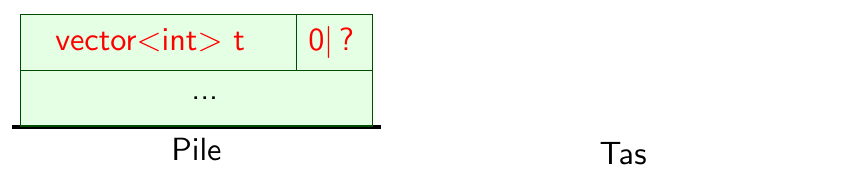
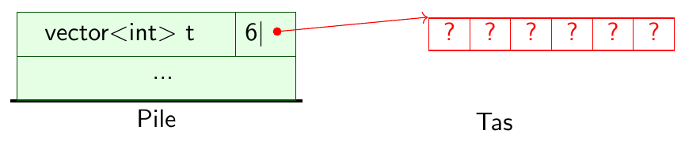
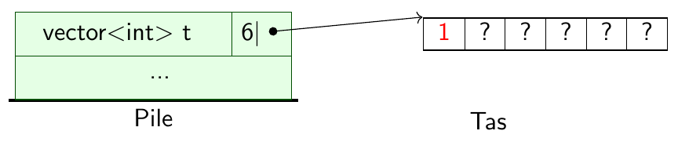
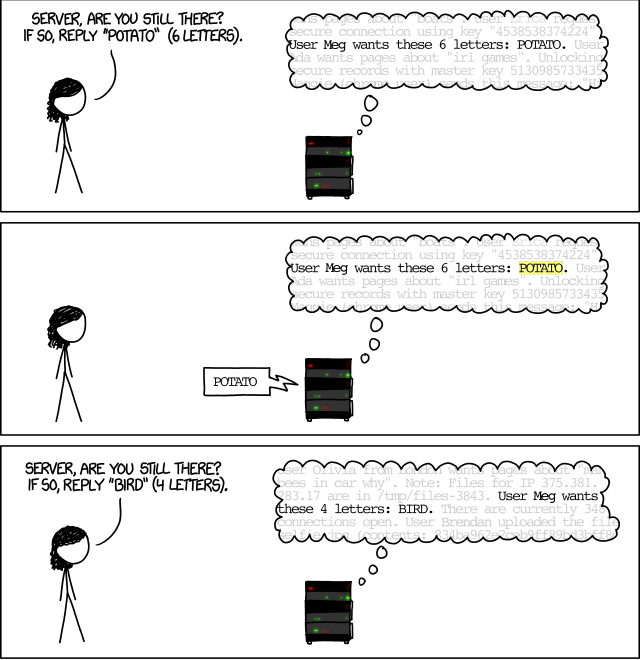
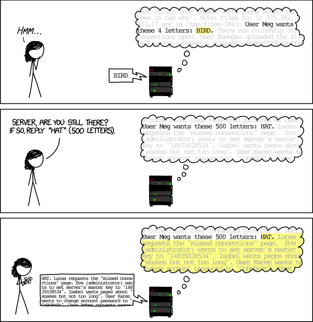

---
jupytext:
  notebook_metadata_filter: rise
  text_representation:
    extension: .md
    format_name: myst
    format_version: 0.13
    jupytext_version: 1.10.3
kernelspec:
  display_name: C++14
  language: C++14
  name: xcpp14
rise:
  auto_select: first
  autolaunch: false
  centered: false
  controls: false
  enable_chalkboard: true
  height: 100%
  margin: 0
  maxScale: 1
  minScale: 1
  scroll: true
  slideNumber: true
  start_slideshow_at: selected
  transition: none
  width: 90%
---

+++ {"slideshow": {"slide_type": "slide"}}

# Modèle de mémoire et tableaux

L'espace mémoire d'un programme est partagé en deux zones:

-   La *pile*: variables locales des fonctions
-   Le *tas*: le reste

+++ {"slideshow": {"slide_type": "fragment"}}

## Exemple de construction d'un tableau

```{code-cell}
#include<vector>
using namespace std;
```

```{code-cell}
---
slideshow:
  slide_type: fragment
---
vector<int> t;      // Déclaration
t = vector<int>(6); // Allocation
t[0] = 1;           // Initialisation
t[1] = 4;
t[2] = 1;
t[3] = 5;
t[4] = 9;
```

+++ {"slideshow": {"slide_type": "subslide"}}

### Exemple de construction d'un tableau: mémoire

0. État initial

    

+++ {"slideshow": {"slide_type": "fragment"}}

1.  Déclaration du tableau

    ``` c++
        vector<int> t;
    ```

    

+++ {"slideshow": {"slide_type": "fragment"}}

2.  Allocation du tableau

    ``` c++
        t = vector<int>(6);
    ```

    

+++ {"slideshow": {"slide_type": "fragment"}}

3.  Initialisation

    ``` c++
        t[0] = 1;
        ...
    ```

    

+++ {"slideshow": {"slide_type": "subslide"}}

## Sémantique: Allocation d'un tableau

``` c++
t = vector<int>(6);
```

1.  Une suite contiguë de cases est allouée sur le tas

2.  La taille et une référence vers la première des cases est stockée
    dans `t`

+++ {"slideshow": {"slide_type": "fragment"}}

## Sémantique: Lecture et écriture dans un tableau

``` c++
t[i]
```

-   Donne la `i`-ème case du tableau
-   Obtenue en suivant la référence et se décalant de $i$ cases
-   Rappel: *pas de vérifications!!!*

+++ {"slideshow": {"slide_type": "subslide"}}

## Retour sur l'[exemple de piratage par débordement](cours-login.md)

+++ {"slideshow": {"slide_type": "subslide"}}

### Heartblead expliqué (<http://xkcd.com/1354/>)




+++ {"slideshow": {"slide_type": "subslide"}}

## Tableaux et allocation mémoire

**À retenir:**

-   Une valeur de type tableau ne contient pas directement les cases du
    tableau, mais l'adresse en mémoire de celles-ci (référence) et la
    taille du tableau.

+++ {"slideshow": {"slide_type": "fragment"}}

-   Une variable de type tableau se construit en trois étapes:

    1.  Déclaration

    2.  Allocation
        Sans cela: *faute de segmentation* (au mieux!)

    3.  Initialisation
        Sans cela: même problème qu'avec les variables usuelles

+++ {"slideshow": {"slide_type": "fragment"}}

-   Lors de l'accès à une case `i` d'un tableau `t`, il faut toujours
    vérifier les bornes: `0 <= i` et `i < t.size()`  
    Sans cela: *faute de segmentation* (au mieux!)

+++ {"slideshow": {"slide_type": "subslide"}}

## Sémantique: affectation de tableaux

**Exemple:**

Quelles sont les valeurs de `t[0]` et `t2[0]` après l'exécution du
programme suivant?

```{code-cell}
---
slideshow:
  slide_type: fragment
---
vector<int> t = { 1, 4, 1, 5, 9, 2 };
vector<int> t2;
t2 = t;             // Affectation
t2[0] = 0;
```

+++ {"slideshow": {"slide_type": "fragment"}}

**À retenir:**

-   En C++, lors d'une affectation, un `vector` est *copié*!
-   On dit que `vector` a une **sémantique de copie**
-   Différent de Java, Python ou des `array` en C!

+++ {"slideshow": {"slide_type": "subslide"}}

## Sémantique: tableaux et fonctions ♣

**Exemple:**

Quelle est la valeur de tableau[0] après l'exécution du programme
suivant?

```{code-cell}
---
slideshow:
  slide_type: fragment
---
void modifie(vector<int> tableau) {
    tableau[0] = 42;
}
```

```{code-cell}
---
slideshow:
  slide_type: fragment
---
vector<int> tableau = { 1, 2, 3, 4 };
modifie(tableau);
```

+++ {"slideshow": {"slide_type": "fragment"}}

**Fonctions et tableaux:**

-   Affectation des paramètres $\Longrightarrow$ copie
-   Donc, les `vector` de C++ sont passés **par valeur** aux fonctions

+++ {"slideshow": {"slide_type": "fragment"}}

-   Mais la fonction peut renvoyer le tableau modifié!
