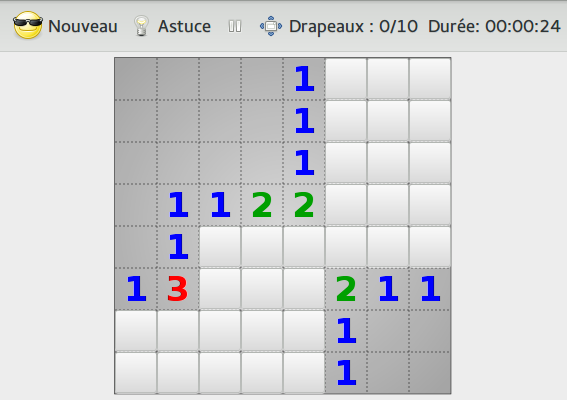

---
jupytext:
  text_representation:
    extension: .md
    format_name: myst
    format_version: 0.13
    jupytext_version: 1.11.5
kernelspec:
  display_name: Python 3 (ipykernel)
  language: python
  name: python3
---

+++ {"deletable": false, "editable": false, "nbgrader": {"cell_type": "markdown", "checksum": "9425616d8843641498acfb7e0ec0a771", "grade": false, "grade_id": "cell-415f04d27b610548", "locked": true, "schema_version": 3, "solution": false, "task": false}}

# Semaine 7: tableaux à deux dimensions

+++ {"deletable": false, "editable": false, "nbgrader": {"cell_type": "markdown", "checksum": "e1813f7d80a897e86cbaf2742cff5b27", "grade": false, "grade_id": "cell-6d952c4decd8c705", "locked": true, "schema_version": 3, "solution": false, "task": false}}

Vous trouverez ici le matériel pédagogique pour la Semaine 7
qui porte sur les tableaux à deux dimensions et les exceptions.

<!--Vous pouvez aussi consulter l'[ancien poly de cours](http://nicolas.thiery.name/Enseignement/Info111/Cours/Cours-4-Tableaux.pdf) qui vous a été distribué en papier.!-->

<!--
+++ {"nbgrader": {"grade": false, "grade_id": "cell-cfd11ec03d13c3cc", "locked": true, "schema_version": 3, "solution": false, "task": false}}

## Planning

En amphi virtuel lundi matin, nous ferons une séance de questions-réponses sur le [cours](#Cours) et les exercices ([salle virtuelle](https://ecampus.paris-saclay.fr/course/view.php?id=24335#section-5), [Foire-Aux-Questions](https://hackmd.io/8HdflibvTa29H_70WpMexA)). Cette semaine, il y aura peu de nouveaux éléments dans le cours.
Cela laissera donc du temps pour:
- Travailler les [exercices PLaTon «tableaux 2D simples»](https://ecampus.paris-saclay.fr/course/view.php?id=30506#section-4);
- Commencer les exercices de TD et TP.

En TD, nous continuerons les exercices de la feuille de TD.

En TP, nous continuerons les exercices de TP ci-dessous.

+++ {"nbgrader": {"grade": false, "grade_id": "cell-d6922b9cbb899cac", "locked": true, "schema_version": 3, "solution": false, "task": false}}

## Consignes

- Avant l'amphi virtuel:
    - relire les cours sur les [tableaux](http://nicolas.thiery.name/Enseignement/Info111/Cours/Cours-4-Tableaux.pdf) et les [collections](http://nicolas.thiery.name/Enseignement/Info111/Cours/Cours-5-Collections.pdf) (disponible aussi dans votre poly papier).
    - travailler les [exercices PLaTon «tableaux simples», «boucles imbriquées» et «tableaux»](https://ecampus.paris-saclay.fr/course/view.php?id=30506#section-4).
- Avant le TD: avoir lu le [sujet de TD](TD.pdf) et commencé les exercices
- Avant le TP: avoir lu le sujet de TP<br>
  LDD IM et MNSI: avoir fait les exercices de TD

Plus vous faites d'exercices en amont des TDs et TPs, plus vous êtes efficaces:
cela vous permet en effet de bénéficier de l'aide de vos enseignants lorsque
vous en avez le plus besoin.
!-->

+++ {"deletable": false, "editable": false, "nbgrader": {"cell_type": "markdown", "checksum": "e54a9f574fa9a2bab30b845dd65e6b9c", "grade": false, "grade_id": "cell-bf8b493b391072c0", "locked": true, "schema_version": 3, "solution": false, "task": false}}

## <a name=Cours>Cours</a>

- Cours: tableaux 2D; cf le [cours sur les collections](http://nicolas.thiery.name/Enseignement/Info111/Cours/Cours-5-Collections.pdf).
- Cours: [exceptions](cours-exceptions.md) (vous pouvez aussi consulter le poly papier, à la fin du cours sur les fichiers).

+++ {"deletable": false, "editable": false, "nbgrader": {"cell_type": "markdown", "checksum": "9be176b01e21e0bafc153e49490f4067", "grade": false, "grade_id": "cell-4f505b81ce738fdd", "locked": true, "schema_version": 3, "solution": false, "task": false}}

## <a href="TD.pdf">TD</a>

+++ {"deletable": false, "editable": false, "nbgrader": {"cell_type": "markdown", "checksum": "a19c3f9a54cc2b0f7cb7ec988963186c", "grade": false, "grade_id": "cell-666b2425eb568c70", "locked": true, "schema_version": 3, "solution": false, "task": false}}

## TP

+++ {"deletable": false, "editable": false, "nbgrader": {"cell_type": "markdown", "checksum": "de47f5571f3aab37cd99da716421a3c7", "grade": false, "grade_id": "cell-537f2c0199cca471", "locked": true, "schema_version": 3, "solution": false, "task": false}}

**Préalable:**
- Téléchargez le sujet de TP selon la
  [procédure usuelle](http://nicolas.thiery.name/Enseignement/Info111/devoirs.html).

+++ {"deletable": false, "editable": false, "nbgrader": {"cell_type": "markdown", "checksum": "7761bd22e8177c8b69f23f433d192c5b", "grade": false, "grade_id": "cell-ebc1119e2f2dc021", "locked": true, "schema_version": 3, "solution": false, "task": false}}

Mis à part le premier exercice qui sera fait avec Jupyter, tout le reste du TP sera programmé avec de la compilation dans un terminal.

+++ {"deletable": false, "editable": false, "nbgrader": {"cell_type": "markdown", "checksum": "83eea73a5aec33966dcb8433179d45ba", "grade": false, "grade_id": "cell-606e498c0e61ce89", "locked": true, "schema_version": 3, "solution": false, "task": false}}

### Exercice: Déclaration, Allocation, Initialisation et Affichage de tableaux 2D

- [tableaux2D-prise-en-main](tableaux2D-prise-en-main.md).

+++ {"deletable": false, "editable": false, "nbgrader": {"cell_type": "markdown", "checksum": "c8e535b65371ed8b33737eff686b2660", "grade": false, "grade_id": "cell-2c464f5229386965", "locked": true, "schema_version": 3, "solution": false, "task": false}}

### Consignes pour les exercices suivants

**<div style="color:red">À lire très attentivement!</div>**

Pour chaque exercice suivant, un fichier squelette est fourni
dans le sujet. Ouvrez le avec votre éditeur de texte favori et
complétez le en **remplaçant** les lignes de la forme
```c++
    // Remplacer la ligne suivante par le code adéquat
    throw runtime_error("Fonction nombreMines non implanté ligne 33");
```
par votre code. Comme on a vu dans le cours,
`throw` signale une erreur: ici le fait que la fonction n’est pas encore
implanté; **veillez à ce que cette ligne (et tant qu'à faire le commentaire) soient bien
supprimés!**

Une fois le fichier complété, il faut le compiler dans un terminal: aller
dans le répertoire:

      cd ~/ProgImperative/Semaine7

puis lancer la commande:

      info-111 g++ nomFichier.cpp -o nomFichier

Pour exécuter le programme compilé, il faut taper:

      ./nomFichier

**Attention**: Il est recommandé de compiler et d'exécuter vos fichiers à
chaque fois que vous avez écrit une fonction, afin de détecter les
erreurs au fur et à mesure.

Pourquoi compiler avec `info-111 g++`? Vous pouvez tout aussi bien,
comme la semaine dernière, compiler directement avec `g++`:

      g++ -std=c++11 nomFichier.cpp -o nomFichier

Simplement, `info-111 g++` rajoute automatiquement `-std=c++11` et
quelques autres options pratiques pour débogguer ou pour mieux détecter
les erreurs. Regardez les messages affichés et notez lesquelles! Ainsi,
si vous travaillez chez vous directement sur votre ordinateur et n’avez
pas la commande info-111, vous pourrez continuer à bénéficier de ces
options.

+++ {"deletable": false, "editable": false, "nbgrader": {"cell_type": "markdown", "checksum": "f5582c8b4ee9f501192c45a4e74d7160", "grade": false, "grade_id": "cell-f8fcdff1ebaa312a", "locked": true, "schema_version": 3, "solution": false, "task": false}}

### Exercice: Déclaration, Allocation et Initialisation de tableau 2D

Éditer le fichier [tableau2D-initialisation.cpp](tableau2D-initialisation.cpp) pour le compléter, le
compiler et l’exécuter pour le vérifier.

+++ {"deletable": false, "editable": false, "nbgrader": {"cell_type": "markdown", "checksum": "90e42b17013b4aa33f0adbad16c3bc88", "grade": false, "grade_id": "cell-cc80d644d587183f", "locked": true, "schema_version": 3, "solution": false, "task": false}}

### Exercice: Opérations sur Tableaux à deux dimensions

Faire la même chose (éditer, compléter, compiler, exécuter, tester) avec
les fichiers:

-   [tableaux2D.cpp](tableaux2D.cpp)
-   [matrices.cpp](matrices.cpp)
-   [occupation-salle.cpp](occupation-salle.cpp)

+++ {"deletable": false, "editable": false, "nbgrader": {"cell_type": "markdown", "checksum": "827730c8f0c0381b914ccc50340db357", "grade": false, "grade_id": "cell-169e43a861dae536", "locked": true, "schema_version": 3, "solution": false, "task": false}}

### Exercice ♣: Le jeu du démineur

Faites la même chose (éditer, compléter, compiler, exécuter, tester)
avec le fichier [demineur.cpp](demineur.cpp) pour implanter le jeu du démineur du <a href="TD.pdf">TD</a>.


