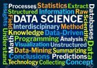
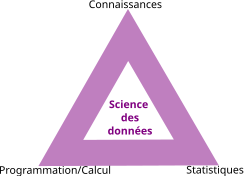
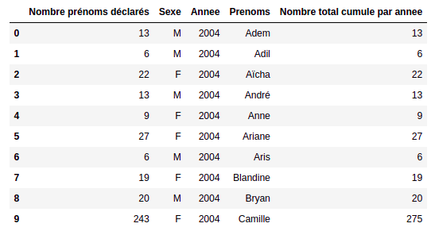

---
jupytext:
  notebook_metadata_filter: rise
  text_representation:
    extension: .md
    format_name: myst
    format_version: 0.13
    jupytext_version: 1.11.5
kernelspec:
  display_name: Python 3
  language: python
  name: python3
rise:
  auto_select: first
  autolaunch: false
  centered: false
  controls: false
  enable_chalkboard: true
  height: 100%
  margin: 0
  maxScale: 1
  minScale: 1
  scroll: true
  slideNumber: true
  start_slideshow_at: selected
  transition: none
  width: 90%
---

+++ {"slideshow": {"slide_type": "slide"}}

<center>

# Cours: Initiation à la Science des données

</center>

<center>Fanny Pouyet</center>

<center>L1 Informatique</center>

<center>Janvier - Mai 2022</center>


+++ {"slideshow": {"slide_type": "slide"}}

<center>

## Présentation de l'UE ISD

</center>

### Sommaire

1. Les enseignantes et enseignants
2. Qu'est-ce que la science des données ?
3. Objectifs de l'UE
3. Liens utiles
4. Organisation, dates importantes et modalités d'évaluation

+++ {"slideshow": {"slide_type": "slide"}}

### Les enseignantes et enseignants

Responsables du cours:
* Fanny Pouyet, Maitresse de conférences en bioinformatique
* Nicolas Thiéry, Professeur en combinatoire 

Chargées et chargés de TP:
* Balthazar Charles
* Stéphanie Chevallier
* Marine Djaffardjy
* Téo Sanchez

+++ {"slideshow": {"slide_type": "slide"}}

### Qu'est-ce que la science des données

#### La science des données, une spécialité interdisciplinaire


[](https://www.dreamstime.com/data-science-word-cloud-blue-background-data-science-word-cloud-image139448154)

+++ {"slideshow": {"slide_type": "slide"}}

#### Les expertises en science des données

La science des données correspond à la récupération, l'analyse et l'interprétation de données.
Les données doivent etre transformées et préparées (c'est ce qui prend le plus de temps).



+++ {"slideshow": {"slide_type": "slide"}}

#### Qu'est ce que sont «les données» ?
Les données sont diverses. Tout est "données". Généralement, elles prendront la forme d'une table avec en colonne des *attributs* et en ligne des *instances*.

**Exemple**: L'administration rend disponible de plus en plus de données comme la liste des prénoms donnés à Paris entre 2004 et aujourd'hui (disponible ici: [opendata](https://opendata.paris.fr/explore/dataset/liste_des_prenoms))


- Comment obtenir et traiter ce genre de données? (voir ci-après)
- Une fois qu'on a cette table, que peut-on en dire ? (voir le 1er TP :) )

```{code-cell}
---
slideshow:
  slide_type: subslide
---
#Obtention de la table en Python
## 1. Téléchargement de la liste des prénoms si ce n'est déjà fait

!if [ ! -f liste_des_prenoms.csv ]; then  \
    curl https://opendata.paris.fr/explore/dataset/liste_des_prenoms/download/\?format\=csv\&timezone\=Europe/Berlin\&lang\=fr\&use_labels_for_header\=true\&csv_separator\=%3B -o liste_des_prenoms.csv; \
fi

## 2. Importation des librairies: pandas pour manipuler des données
import pandas as pd

## 3. Chargement de la table en Python
prenoms = pd.read_csv('liste_des_prenoms.csv', sep=';')
prenoms.head(7)
```

+++ {"slideshow": {"slide_type": "slide"}}

### Objectifs de l'UE

* *Compréhension*

On verra que les sciences des données sont omni-présentes dans nos
vies. On apprendra aussi à utiliser des outils d'apprentissage
statistique (*machine learning*).

* *Raisonnement* 

Être capable de lire une figure/une infographie dans les médias. Être capable de différencier: l'observation (qu'est ce que je vois?) et l'interprétation (qu'est ce que cela veut dire?). 

*  *Technicité* 

Faire de l'analyse de données **en Python** : l'analyse de tables et
la classification d'objets par apprentissage statistique

+++ {"slideshow": {"slide_type": "slide"}}

### Liens utiles

1. [Page web](http://nicolas.thiery.name/Enseignement/IntroScienceDonnees/):
   cours, sujets de TP, ...

2. [Espace e-Campus](https://ecampus.paris-saclay.fr/course/view.php?id=57746):
   - [Forum d'aide](https://ecampus.paris-saclay.fr/enrol/index.php?id=57746)
   - ...

3. Pb de code ? Quelqu'un a surement déjà eu le meme problème, n'hésitez pas a glaner des infos sur stackoverflow ou openclassrooms 

4. Mon mail: fanny.pouyet@universite-paris-saclay.fr

+++ {"slideshow": {"slide_type": "slide"}}

### Organisation de l'UE

- 10 semaines avec : 1h à 1h30 de CM et 2h de TP
- CM = mise en contexte + présentation des notions
- TP = apprentissage pratique + technicité (attention: on ne redéfinira pas les notions en TP!!)

#### Modalités d'évaluation

- les TP notés (30% de la note finale)
- 2 projets en binôme dont le dernier avec soutenance orale finale (sujet: classification d'images à l'aide de méthodes de machine learning) (20% + 30% de la note finale)
- 2 quizz sur le cours (20% de la note finale)


#### Infrastructure du cours

L'infrastructure est similaire à celle du cours Introduction à la
Programmation Impérative:

- [Espace e-Campus](https://ecampus.paris-saclay.fr/course/view.php?id=57746):
   - Annonces, [Forum d'aide](https://ecampus.paris-saclay.fr/enrol/index.php?id=57746)
   - QCM, salles de TP et horaires, ...
- [page web](https://nicolas.thiery.name/Enseignement/IntroScienceDonnees/): matériel pédagogique
- Salles de TP au 336
- Salles de TP virtuelle: [JupyterHub@Paris-Saclay](https://jupyterhub.ijclab.in2p3.fr/)
- Forge logicielle [GitLab](https://gitlab.dsi.universite-paris-saclay.fr/)
- Script de gestion de devoirs `intro-science-donnees` basé sur [travo](https://gitlab.info.uqam.ca/travo/travo)

+++ {"slideshow": {"slide_type": "slide"}}

### Calendrier

* Semaine 1 et 2 : tutoriels et analyses de données
* Semaine 3 : chaine complète en science des données 
* Semaine 4 et 5 : Projet 1 **en binôme** 
* *VACANCES de Février*
* Semaine 6 : Traitement des données
* Semaine 7 à 9 : Projet 2 **en binôme**
* Semaine 10 : Soutenances **en binôme** (début avril)

+++ {"slideshow": {"slide_type": "slide"}}

### Rendus des TPs et Projets

**Avant le lundi 21h00** avec le script `intro-science-donnees` (mise en place lors du TP1) pour deux raisons:

- nous laisser le temps de les corriger
- vous permettre de passer à autre chose
