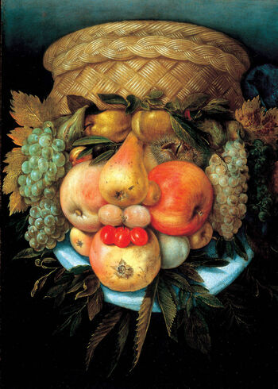
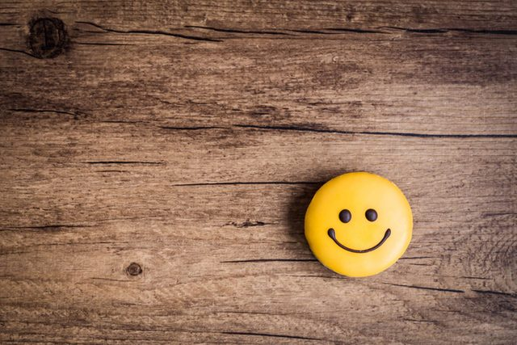

---
jupytext:
  text_representation:
    extension: .md
    format_name: myst
    format_version: 0.13
    jupytext_version: 1.11.5
kernelspec:
  display_name: Python 3 (ipykernel)
  language: python
  name: python3
---

+++ {"deletable": false, "editable": false, "nbgrader": {"cell_type": "markdown", "checksum": "d53824e065ad5ba1ac1ce5cf3895adcc", "grade": false, "grade_id": "cell-4911a792a82448d7", "locked": true, "schema_version": 3, "solution": false}}

# Traitement d'images

+++ {"deletable": false, "editable": false, "nbgrader": {"cell_type": "markdown", "checksum": "dc915558666bf51cc706c5ec7f5a1049", "grade": false, "grade_id": "cell-4911a792a82448d8", "locked": true, "schema_version": 3, "solution": false}}



[Giuseppe Arcimboldo](https://en.wikipedia.org/wiki/Giuseppe_Arcimboldo)
était un peintre du 16ème siècle qui a créé des portraits imaginaires
à partir de fruits, légumes, fleurs, poissons et livres.

+++ {"deletable": false, "editable": false, "nbgrader": {"cell_type": "markdown", "checksum": "db3b1229531d4106908337f989322015", "grade": false, "grade_id": "cell-4911a792a82448d5", "locked": true, "schema_version": 3, "solution": false}}

## Objectif

+++ {"deletable": false, "editable": false, "nbgrader": {"cell_type": "markdown", "checksum": "f1661fb330f1fc00bd07d475da675a75", "grade": false, "grade_id": "cell-4911a792a82448dz", "locked": true, "schema_version": 3, "solution": false}}

Dans cette feuille, vous allez créer une séquence d'images
transformant pas à pas le smiley ci-dessous en une peinture à la
Arcimboldo, puis les assembler pour réaliser une petite animation!
Vous pourrez ensuite épicer votre réalisation avec [Deep Art](https://deepart.io/).



+++ {"deletable": false, "editable": false, "nbgrader": {"cell_type": "markdown", "checksum": "0ea379e4c59fcf45e228928a04a00d1d", "grade": false, "grade_id": "cell-0ab4b2cc4ca88a9d", "locked": true, "schema_version": 3, "solution": false, "task": false}}

Voici les étapes du projet:

0. Extraire la partie droite de l'image pour avoir une image carrée
1. Extraire le smiley de son fond
2. Recadrer l'image sans changement de résolution, de sorte à obtenir
   une image de taille 256x256 centrée sur le smiley,
1. Réduire la résolution à 128x128, avec une technique anti-crénelage,
   par lissage puis sous-échantillonage.
2. Extraire les contours du smiley pour en faire une image noir et
   blanc.
3. Mettre en toile de fond un papier-peint représentant des fruits
4. Choisir trois images de fruits et les extraires de leur fond.
5. Remplacer les yeux et la bouche par ces fruits

Lors de ces étapes, guidées pas-à-pas, vous apprendrez à:

* Appliquer un filtre pixel-à-pixel pour extraire le premier plan
  d'une image
* Appliquer un filtre de convolution, construire une pyramide
  Gaussienne et choisir le bon niveau de lissage avant de
  sous-échantillonner.
* Appliquer un filtre de convolution par différence pour extraire un
  contour.

```{code-cell} ipython3
---
deletable: false
editable: false
nbgrader:
  cell_type: code
  checksum: 5393a8e2c024495685c5a76806a0cdd4
  grade: false
  grade_id: cell-8b77acf5d2044f9d
  locked: true
  schema_version: 3
  solution: false
  task: false
---
# Automatically reload code when changes are made
%load_ext autoreload
%autoreload 2
from PIL import Image, ImageDraw, ImageFont
import matplotlib.pyplot as plt
from scipy import signal

from intro_science_donnees import *
from utilities import *
```

+++ {"deletable": false, "editable": false, "heading_collapsed": true, "nbgrader": {"cell_type": "markdown", "checksum": "6fb6239a02348e4b02e5ce212099fde0", "grade": false, "grade_id": "cell-4911a792a82448d6", "locked": true, "schema_version": 3, "solution": false}}

## Lecture de l'image et extraction d'une sous image carrée

+++ {"deletable": false, "editable": false, "hidden": true, "nbgrader": {"cell_type": "markdown", "checksum": "9b3245ba8f6c0d9b9a748dfd59c5b9d0", "grade": false, "grade_id": "cell-f9c262f57c64875f", "locked": true, "schema_version": 3, "solution": false, "task": false}}

**Exercice:** Chargez l'image `smiley.jpg` situé dans le dossier `media` et affectez-la à la variable `img`.

**Indication:** consultez la feuille [image](../Semaine4/2_images.md) de la Semaine4 si besoin.

```{code-cell} ipython3
---
deletable: false
hidden: true
nbgrader:
  cell_type: code
  checksum: 1800c1d3d0958a6c5b5336fad812febd
  grade: false
  grade_id: cell-92bac537558258c7
  locked: false
  schema_version: 3
  solution: true
  task: false
---
dataset_dir = os.path.join("media")
images = load_images(dataset_dir, "*.jpg")
img = images[1]
image_grid(images)
```

```{code-cell} ipython3
---
deletable: false
editable: false
hidden: true
nbgrader:
  cell_type: code
  checksum: c87c89764765110747a34fa70e4b8dc4
  grade: true
  grade_id: cell-c675bf3b26f50459
  locked: true
  points: 1
  schema_version: 3
  solution: false
  task: false
---
assert img.width == 640
assert img.height == 427
```

+++ {"deletable": false, "editable": false, "hidden": true, "nbgrader": {"cell_type": "markdown", "checksum": "99dd434f1a670078504010b1634a6551", "grade": false, "grade_id": "cell-ed8c5d85b92064e9", "locked": true, "schema_version": 3, "solution": false, "task": false}}

La bibliothèque `PIL` fournit une méthode `crop` pour recadrer des images. Elle prend en paramètre une liste `(left, upper, right, lower)` donnant successivement les coordonnées des points en haut à gauche et en bas à droite de la zone rectangulaire (*box*) à extraire. Voici, par exemple, l'image recadrée pour les points de coordonnées (0,0) et (200,100):

```{code-cell} ipython3
---
deletable: false
editable: false
hidden: true
nbgrader:
  cell_type: code
  checksum: 99316d61711c5af8a68ee8e446bc30c8
  grade: false
  grade_id: cell-fb8b435f0255e63a
  locked: true
  schema_version: 3
  solution: false
  task: false
---
img.crop(box=(0,0,200,100) )
```

+++ {"deletable": false, "editable": false, "hidden": true, "nbgrader": {"cell_type": "markdown", "checksum": "83327c09f24d9bdfb0587781cf955436", "grade": false, "grade_id": "cell-81da809741dda4f6", "locked": true, "schema_version": 3, "solution": false, "task": false}}

**Exercice:** Recadrer l'image pour ne garder que sa partie droite et de sorte à ce qu'elle soit carrée. Affectez le résultat à la variable `img_carree`.

**Indication :** Faites un dessin sur papier. Quel coin garder ? Comment trouver les autres coordonnées ? Pour cela, commencez par identifier la plus petite dimension entre la largeur (width) et la hauteur (height).

```{code-cell} ipython3
---
deletable: false
hidden: true
nbgrader:
  cell_type: code
  checksum: 62b0b78f2196a2d0e53c180aec2adc6f
  grade: false
  grade_id: cell-3fd205dc2e602eb8
  locked: false
  schema_version: 3
  solution: true
  task: false
---
img_carree = img.crop(box=(img.width-img.height,0,img.width,img.height) )
img_carree
```

```{code-cell} ipython3
---
deletable: false
editable: false
hidden: true
nbgrader:
  cell_type: code
  checksum: 18bf2d3acd2515b191ece39d2725049c
  grade: true
  grade_id: cell-6d458608eabf2832
  locked: true
  points: 1
  schema_version: 3
  solution: false
  task: false
---
# Vérifications: on obtient une image de la bonne taille
assert isinstance(img_carree, Image.Image)
assert img_carree.size == (427, 427)
```

+++ {"deletable": false, "editable": false, "hidden": true, "nbgrader": {"cell_type": "markdown", "checksum": "6cc1c7ee723a542f67ba8daf3a57d783", "grade": false, "grade_id": "cell-102f16e91f85d795", "locked": true, "schema_version": 3, "solution": false, "task": false}}

Ce sera la première image de votre animation!

Pour produire cette dernière, vous stockerez les images successives dans une liste `images`,
puis les assemblerez à la fin. Commençons par celle-ci:

```{code-cell} ipython3
---
deletable: false
editable: false
hidden: true
nbgrader:
  cell_type: code
  checksum: 46be2e4904f3961538e94ad56488a904
  grade: false
  grade_id: cell-b5f655311351c33e
  locked: true
  schema_version: 3
  solution: false
  task: false
---
# Initialise une liste d'images vide
images = []
# Rajoute une image à la fin
images.append(img_carree)
```

+++ {"deletable": false, "editable": false, "hidden": true, "nbgrader": {"cell_type": "markdown", "checksum": "8a23ab53869240c1f887d50ef6d05171", "grade": false, "grade_id": "cell-411b36bd0cb5826d", "locked": true, "schema_version": 3, "solution": false, "task": false}}

La méthode `append` permet d'ajouter des élements à la fin d'une liste. Nous la réutiliserons pour mettre à jour `images` au fur et à mesure du TP.

```{code-cell} ipython3
---
deletable: false
editable: false
hidden: true
nbgrader:
  cell_type: code
  checksum: fcaa975d6d815192f97e058cc9310adf
  grade: false
  grade_id: cell-181b4e0dd4bfe5da
  locked: true
  schema_version: 3
  solution: false
  task: false
---
image_grid(images)
```

+++ {"deletable": false, "editable": false, "nbgrader": {"cell_type": "markdown", "checksum": "4fdcc3eb6ec5aea2d6eb9f819068b43a", "grade": false, "grade_id": "cell-3c64df0a682e05ba", "locked": true, "schema_version": 3, "solution": false, "task": false}}

## Le générique de l'animation

+++ {"deletable": false, "editable": false, "nbgrader": {"cell_type": "markdown", "checksum": "71e777314e65f91d822baf379702cc05", "grade": false, "grade_id": "cell-3c64df0a682e05bb", "locked": true, "schema_version": 3, "solution": false, "task": false}}

Lorsque l'on produit une œuvre, ici une animation, l'attribution de l'œuvre à ses auteurs est un élément indispensable. Pour cela, vous allez maintenant écrire votre nom et prénom sur l'image. 

**Exercice :**
1. Affectez votre nom à la variable `name`.

```{code-cell} ipython3
---
deletable: false
nbgrader:
  cell_type: code
  checksum: a1e953e431ffdebb9e8b1a4b74cb4f9e
  grade: false
  grade_id: cell-be303b49eea2cef9
  locked: false
  schema_version: 3
  solution: true
  task: false
---
name = "Raphaël Thieffry"
formation = "LDDIM2"
```

```{code-cell} ipython3
---
deletable: false
editable: false
nbgrader:
  cell_type: code
  checksum: 4f0bb030fb7b816af6fef371b72e19a6
  grade: true
  grade_id: cell-e5297ed9595b81ed
  locked: true
  points: 1
  schema_version: 3
  solution: false
  task: false
---
assert isinstance(name, str)
```

+++ {"deletable": false, "editable": false, "nbgrader": {"cell_type": "markdown", "checksum": "08a20ac0882ff4ad9caa215556b63bbd", "grade": false, "grade_id": "cell-d3dd8f14b08a316d", "locked": true, "schema_version": 3, "solution": false, "task": false}}

2. Étudiez en détail les quatre commandes suivantes qui respectivement:
    - font une copie de l'image
    - construisent un canevas pour dessiner sur cette image
    - choisissent une fonte (si 'LiberationSans-Regular' n'est pas disponible, essayez 'Arial' à la place)
    - dessinent un texte

+++

# NE PAS EXECUTER LA CELLULE CI DESSOUS

```{code-cell} ipython3
---
deletable: false
editable: false
nbgrader:
  cell_type: code
  checksum: b01a8e66d0a037574c975aa88cddfb26
  grade: false
  grade_id: cell-19ee6a31a2222995
  locked: true
  schema_version: 3
  solution: false
  task: false
---
img_title = img_carree.copy()
canvas = ImageDraw.Draw(img_title)
font = ImageFont.truetype("LiberationSans-Regular.ttf", size=40)
canvas.text(xy=(100,10), text=name, font=font)
```

#### Il faut executer celle ci

```{code-cell} ipython3
generique = []
for i in range(0,int(img.height/80)):
    img_title = img_carree.copy()
    canvas = ImageDraw.Draw(img_title)
    font = ImageFont.truetype("LiberationSans-Regular.ttf", size=40)
    canvas.text(xy=(90,i*80), text=name, font=font, stroke_width=3, fill = 'magenta')
    canvas.text(xy=(150,50+i*80), text=formation, font=font)
    generique.append(img_title)
image_grid(generique)
```

+++ {"deletable": false, "editable": false, "nbgrader": {"cell_type": "markdown", "checksum": "5a7821e0b2221dde112bf859f4032327", "grade": false, "grade_id": "cell-fb141f73fee79810", "locked": true, "schema_version": 3, "solution": false, "task": false}}

3. Affichez l'image

```{code-cell} ipython3
---
deletable: false
nbgrader:
  cell_type: code
  checksum: 109f0e0e9cc82ff1ed4174166c64d037
  grade: false
  grade_id: cell-6ef52624ea6e4ef0
  locked: false
  schema_version: 3
  solution: true
  task: false
---
generique[3]
```

+++ {"deletable": false, "nbgrader": {"cell_type": "markdown", "checksum": "f6f81b07bfe9374b99731d657a0e96ec", "grade": true, "grade_id": "cell-3783842fee0fa240", "locked": false, "points": 0, "schema_version": 3, "solution": true, "task": false}}

4. Quel argument permet de définir où le texte sera écrit ?

Il s'agit de xy

+++ {"deletable": false, "editable": false, "nbgrader": {"cell_type": "markdown", "checksum": "453e911b24454024175ade5e23f5cefc", "grade": false, "grade_id": "cell-4957e043a46e3b57", "locked": true, "schema_version": 3, "solution": false, "task": false}}

5. Ajoutez l'image produite à la liste `images`

```{code-cell} ipython3
---
deletable: false
nbgrader:
  cell_type: code
  checksum: 8b572230e59b714e9611f44dfaf77a8b
  grade: false
  grade_id: cell-fe1a254856187eff
  locked: false
  schema_version: 3
  solution: true
  task: false
---
images+=generique
image_grid(images)
```

```{code-cell} ipython3
---
deletable: false
editable: false
nbgrader:
  cell_type: code
  checksum: 28f7a8c9617d286c23a79d8865fae807
  grade: true
  grade_id: cell-fe1b25c906541db9
  locked: true
  points: 1
  schema_version: 3
  solution: false
  task: false
---
assert len(images) >= 2
assert images[-1] is img_title
```

+++ {"deletable": false, "editable": false, "nbgrader": {"cell_type": "markdown", "checksum": "bd9d15923205bee520a36eda5626c1a5", "grade": false, "grade_id": "cell-3e3d73027e521171", "locked": true, "schema_version": 3, "solution": false, "task": false}}

6.  ♣ Modifiez ce qui précède pour personnaliser votre générique. Voici quelques idées:
    - explorez les options de `canvas.text` pour dessiner le texte selon vos préférences (couleur, fonte, position, ...);
    - ajoutez non pas une seule image à `images`, mais une séquence d'images de sorte à réaliser un générique qui défile;
    - explorez les fonctions de `canvas` pour réaliser tout dessin de votre goût sur l'image.

    **Indications**:

    - rajoutez autant de cellules ci-dessus que vous en aurez besoin;
    - rassemblez les commandes pour rajouter du texte à une image en une fonction réutilisable dans `utilities.py`

+++ {"deletable": false, "editable": false, "nbgrader": {"cell_type": "markdown", "checksum": "7f61626410f8441af781a7e59adfc3d5", "grade": false, "grade_id": "cell-4911a792a82448d9", "locked": true, "schema_version": 3, "solution": false}}

## Détection de l'avant-plan

+++ {"deletable": false, "editable": false, "nbgrader": {"cell_type": "markdown", "checksum": "ecbe393d97e7399c0503f450bcb12467", "grade": false, "grade_id": "cell-4911a792a82448da", "locked": true, "schema_version": 3, "solution": false}}

L'objectif est maintenant de déterminer la position du smiley sur l'image. Pour cela
nous allons commencer par détecter quels pixels sont dans l'avant-plan (le smiley),
et non dans l'arrière plan.

+++ {"deletable": false, "editable": false, "nbgrader": {"cell_type": "markdown", "checksum": "c21377faaff1cc0f5950deeb292719ae", "grade": false, "grade_id": "cell-4911a792a82448dE", "locked": true, "schema_version": 3, "solution": false}}

### Un premier essai
Reprenons la fonction `foreground_filter` du Projet1, qui est fournie dans
`utilities.py`. Prenez le temps d'en consulter le code pour vous remémorer son
fonctionnement.

```{code-cell} ipython3
---
deletable: false
editable: false
nbgrader:
  cell_type: code
  checksum: bacdf825bb5007973bd8cf069e00480c
  grade: false
  grade_id: cell-9b9253d9b0b88717
  locked: true
  schema_version: 3
  solution: false
  task: false
---
show_source(foreground_filter)
```

+++ {"deletable": false, "editable": false, "nbgrader": {"cell_type": "markdown", "checksum": "c1347399c654bf4e1bbe4b6a5c836ab5", "grade": false, "grade_id": "cell-0dd0b95767f54528", "locked": true, "schema_version": 3, "solution": false, "task": false}}

**Exercice :** Appliquez cette fonction à `img_carree`, affectez le résultat à `foreground0`, et visualisez le résultat:

```{code-cell} ipython3
---
deletable: false
nbgrader:
  cell_type: code
  checksum: f414a70fb3360bd83122a5d68801c4dd
  grade: false
  grade_id: cell-8f9cdf8dced5039c
  locked: false
  schema_version: 3
  solution: true
  task: false
---
foreground0 = foreground_filter(img_carree, theta = 120)
plt.imshow(foreground0, cmap='gray');
```

```{code-cell} ipython3
---
deletable: false
editable: false
nbgrader:
  cell_type: code
  checksum: e3bc7dd05542ef3cb89f23455d90d805
  grade: true
  grade_id: cell-0c85f820a8deac7A
  locked: true
  points: 1
  schema_version: 3
  solution: false
  task: false
---
# Vérifications:
assert isinstance(foreground0, np.ndarray)    # foreground est un tableau ...
assert foreground0.dtype == np.dtype('bool')  # de booléens ...
assert foreground0.shape == img_carree.size   # de même taille que l'image
```

+++ {"deletable": false, "nbgrader": {"cell_type": "markdown", "checksum": "4e284ea927e90e742228626695e24c17", "grade": true, "grade_id": "cell-7d25f207f347ca75", "locked": false, "points": 4, "schema_version": 3, "solution": true, "task": false}}

**Exercice :** 

1.  Le résultat est-il probant? Réessayez avec différentes valeurs de seuil `theta`. Laquelle donne le meilleur résultat?

    Il n'y a pas vraiment de theta qui donne un resultat satisfaisant, mais 120 semble etre moins mauvais que les autres

2.  Est-ce satisfaisant? Quel est le problème?

    Le smiley est tout le temps considéré au moins en parti comme l'arriere plan, et si on regle theta pour ne pas qu'il soit selectionné, le fond n'est plus considéré comme tel

+++ {"deletable": false, "editable": false, "nbgrader": {"cell_type": "markdown", "checksum": "9674bfe39ce88b8814c653ebd6afc126", "grade": false, "grade_id": "cell-1d07ce0e29501025", "locked": true, "schema_version": 3, "solution": false, "task": false}}

### Le smiley a la jaunisse

+++ {"deletable": false, "editable": false, "nbgrader": {"cell_type": "markdown", "checksum": "e31d5545f679d10fd85f74b16010c92f", "grade": false, "grade_id": "cell-5078af8d1168e4f7", "locked": true, "points": 2, "schema_version": 3, "solution": false, "task": true}}

Pour améliorer cela, nous allons utiliser un filtre pixel-à-pixel mesurant non pas le niveau de gris mais le niveau de jaune
de chaque pixel.

**Exercice:**

1.  Implémentez la fonction `yellowness_filter` dans le fichier utilities.py en utilisant la formule $y = r + g - b$ où $y$ est l'intensité du jaune (*yellow*).   
    **Indication:** si vous n'avez plus en tête comment extraire et calculer avec des différentes couches de couleur de l'image, consulter la feuille [ d'extraction d'attributs](../Semaine4/3_extraction_d_attributs.md).

```{code-cell} ipython3
---
deletable: false
editable: false
nbgrader:
  cell_type: code
  checksum: 11ceb1cefcdf32e6c653cffd4adce375
  grade: false
  grade_id: cell-e74810e51cadc155
  locked: true
  schema_version: 3
  solution: false
  task: false
---
show_source(yellowness_filter)
```

+++ {"deletable": false, "editable": false, "nbgrader": {"cell_type": "markdown", "checksum": "c51b2bef7c9dabbb05ea89811984efb8", "grade": false, "grade_id": "cell-fb97b0c5c9669e02", "locked": true, "schema_version": 3, "solution": false, "task": false}}

2.  Appliquez ce filtre à `img_carree` et gardez le résultat dans l'objet `img_yellowness`

```{code-cell} ipython3
---
deletable: false
nbgrader:
  cell_type: code
  checksum: 7578b3022f2a77fddbcc035daae5e1cf
  grade: true
  grade_id: cell-f02aabb90e0f6e9d
  locked: false
  points: 0
  schema_version: 3
  solution: true
  task: false
---
img_yellowness =yellowness_filter(img_carree)
```

+++ {"deletable": false, "editable": false, "nbgrader": {"cell_type": "markdown", "checksum": "e3c93a486b466838d29c939cec5bdabf", "grade": false, "grade_id": "cell-42acfe4f7f9299fb", "locked": true, "schema_version": 3, "solution": false, "task": false}}

Affichons le résultat:

```{code-cell} ipython3
---
deletable: false
editable: false
nbgrader:
  cell_type: code
  checksum: ba4a66def84f2ce55335a3798624d9d4
  grade: false
  grade_id: cell-b879f574ed336fc4
  locked: true
  schema_version: 3
  solution: false
  task: false
---
plt.imshow(img_yellowness, cmap='gray')
plt.colorbar();
```

```{code-cell} ipython3
---
deletable: false
editable: false
nbgrader:
  cell_type: code
  checksum: b6adb6d5fa1e13cdd9339c50f147456b
  grade: true
  grade_id: cell-9505bbe1a0dca07d
  locked: true
  points: 2
  schema_version: 3
  solution: false
  task: false
---
# Vérifications: 
assert isinstance(img_yellowness, np.ndarray)      # img_yellowness est un tableau numpy ...
assert img_yellowness.dtype == np.dtype('float64') # de nombre flottants ...
assert img_yellowness.shape == img_carree.size     # de même taille que l'image
```

+++ {"deletable": false, "nbgrader": {"cell_type": "markdown", "checksum": "9fb6f30603e54bca3fc51f61cb4cd1cc", "grade": true, "grade_id": "cell-d0d9bf57408a8995", "locked": false, "points": 1, "schema_version": 3, "solution": true, "task": false}}

3.  Quelle est la valeur maximale théorique que peut prendre un pixel d' `img_yellowness` ? Et minimale ?

    510 et -255

+++ {"deletable": false, "editable": false, "nbgrader": {"cell_type": "markdown", "checksum": "6b0e25679bb187f782d18403b1663962", "grade": false, "grade_id": "cell-7049a03988b66331", "locked": true, "schema_version": 3, "solution": false, "task": false}}

Ajoutez `img_yellowness` à la liste d'images:

```{code-cell} ipython3
---
deletable: false
nbgrader:
  cell_type: code
  checksum: 7a1afb6e44693f38ea0b16ed632b0296
  grade: false
  grade_id: cell-813fb02227e0342b
  locked: false
  schema_version: 3
  solution: true
  task: false
---
images.append(img_yellowness)
image_grid(images)
```

+++ {"deletable": false, "editable": false, "nbgrader": {"cell_type": "markdown", "checksum": "152512f37866118a569721cf1a981cf4", "grade": false, "grade_id": "cell-21219bc51f06bdf0", "locked": true, "schema_version": 3, "solution": false, "task": false}}

### Généralisons!

+++ {"deletable": false, "editable": false, "nbgrader": {"cell_type": "markdown", "checksum": "10713fe81a624ca4ac94a798f288545b", "grade": false, "grade_id": "cell-e4731c9234724a62", "locked": true, "schema_version": 3, "solution": false, "task": false}}

Notez que la formule $r+g-b$ est un produit scalaire! Nommément, c'est le produit scalaire $v.w$ de la couleur du pixel -- représentée par le vecteur $v = (r,g,b)$ -- avec le vecteur $w=(1,1,-1)$. Le rôle du coefficient $-1$ est de discriminer les couleurs du blanc -- représentée par le vecteur $(255,255,255)$ -- qui contiennent du bleu en plus du jaune.

Une autre façon de discriminer ces couleurs, est de diviser le produit scalaire par la norme de $v$. Cela nous donne alors $\frac{v . w}{|v|}$, où $w=(1,1,0)$. À un coefficient multiplicateur et centrage près, **on retrouve la formule $\frac{\overline v.\overline c}{|\overline v|,|\overline c|}$ de la corrélation de $v$ avec la couleur jaune $c=(255,255,0)$**. La corrélation est maximale lorsque $v$ est proportionnel à $c$, c'est-à-dire que $v$ représente une couleur jaune quelconque, qu'elle soit sombre ou claire.

+++ {"deletable": false, "editable": false, "nbgrader": {"cell_type": "markdown", "checksum": "01fb890b2beda9c04061f91883afbc1b", "grade": false, "grade_id": "cell-59b313505cfba2af", "locked": true, "schema_version": 3, "solution": false, "task": false}}

**Exercice ♣**:

+++ {"deletable": false, "editable": false, "nbgrader": {"cell_type": "markdown", "checksum": "1067874dc5756ca0b5a82ca04eb37f89", "grade": false, "grade_id": "cell-59b313505cfba2bb", "locked": true, "points": 2, "schema_version": 3, "solution": false, "task": true}}

1. Implémenter dans `utilities.py` la fonction  `color_correlation_filter` calculant, pour chaque pixel d'une image, sa corrélation avec une couleur donnée.


    **Indication**: Transformez l'image en array. Puis pour chaque pixel, calculez la corrélation avec la couleur à l'aide de la fonction np.corrcoef(). Utilisez une compréhension. Usage : la fonction de Numpy `np.corrcoef(u, v)[0, 1]` calcule la corrélation entre deux vecteurs `u` et `v`.

```{code-cell} ipython3
---
deletable: false
editable: false
nbgrader:
  cell_type: code
  checksum: 8892fe610d9abdede2ec9d79f9abf08d
  grade: false
  grade_id: cell-e20ed946fc4c4623
  locked: true
  schema_version: 3
  solution: false
  task: false
---
show_source(color_correlation_filter)
```

+++ {"deletable": false, "editable": false, "nbgrader": {"cell_type": "markdown", "checksum": "3fc41830202d13320e5f323dc8d316ab", "grade": false, "grade_id": "cell-59b313505cfba2ag", "locked": true, "schema_version": 3, "solution": false, "task": false}}

2. Appliquer cette fonction à `img_carree` avec la couleur jaune $(255,255,0)$ et affecter le résultat à `img_yellowness`.

```{code-cell} ipython3
---
deletable: false
nbgrader:
  cell_type: code
  checksum: dfc8a7d3ebcd3637197034edd3ed3c39
  grade: false
  grade_id: cell-3ae2b8e0c2a876c0
  locked: false
  schema_version: 3
  solution: true
  task: false
---
yellow = (255,255,0)
img_yellowness_general = color_correlation_filter(img_carree,yellow)
```

+++ {"deletable": false, "editable": false, "nbgrader": {"cell_type": "markdown", "checksum": "0cb1365b5e381f74c8f17fcbe89a77ed", "grade": false, "grade_id": "cell-147c0a1f3588c92f", "locked": true, "schema_version": 3, "solution": false, "task": false}}

3. Affichez le résultat:

```{code-cell} ipython3
---
deletable: false
nbgrader:
  cell_type: code
  checksum: 6548d6fd15e7b7cb2cb7ebe689fb62ef
  grade: false
  grade_id: cell-3ae2b8e0c2a876cA
  locked: false
  schema_version: 3
  solution: true
  task: false
---
plt.imshow(img_yellowness_general, cmap='gray')
```

+++ {"deletable": false, "editable": false, "nbgrader": {"cell_type": "markdown", "checksum": "dc6c9375407b5048bb0942215936971d", "grade": false, "grade_id": "cell-59b313505cfba2ah", "locked": true, "schema_version": 3, "solution": false, "task": false}}

4. Le smiley n'est en fait pas en jaune pur (la corrélation n'est pas exactement de 1). Extraire une zone du smiley et en calculer la couleur moyenne. Puis utiliser cette couleur pour appliquer le filtre.

```{code-cell} ipython3
import math
```

```{code-cell} ipython3
---
deletable: false
nbgrader:
  cell_type: code
  checksum: 1efefd53d03f71394ae3b59784c42b42
  grade: true
  grade_id: cell-0d6c2f11aa28fdcf
  locked: false
  points: 2
  schema_version: 3
  solution: true
  task: false
---
xy = (245,225)
newyellow = zonecolorpicker(img_carree, xy, 5)
print(newyellow)
img_yellowness_general = color_correlation_filter(img_carree,newyellow)
plt.imshow(img_yellowness, cmap="gray")
plt.colorbar();
```

+++ {"deletable": false, "nbgrader": {"cell_type": "markdown", "checksum": "4c41ea07ebe3614e86389615821ea596", "grade": true, "grade_id": "cell-03f8982a2da85728", "locked": false, "points": 1, "schema_version": 3, "solution": true, "task": false}}

5. Quels sont les avantages et inconvénients de cette méthode?

   On doit selectionner la zone manuellement, cependant cela permet d'utiliser un tel filtre pour n'importe quelle nuance de couleur

+++ {"deletable": false, "editable": false, "nbgrader": {"cell_type": "markdown", "checksum": "089009ca57b1a1b5f984cba6c171f6d1", "grade": false, "grade_id": "cell-7049a03988b66332", "locked": true, "schema_version": 3, "solution": false, "task": false}}

6.  Ajoutez `img_yellowness` à la liste d'images:

```{code-cell} ipython3
---
deletable: false
nbgrader:
  cell_type: code
  checksum: fea3b2be1b0b5c4f3b8cc824ad73ed53
  grade: false
  grade_id: cell-813fb02227e0342c
  locked: false
  schema_version: 3
  solution: true
  task: false
---
images.append(img_yellowness_general)
image_grid(images)
```

+++ {"deletable": false, "editable": false, "nbgrader": {"cell_type": "markdown", "checksum": "f3250f4092c450ea19ed0826c4765751", "grade": false, "grade_id": "cell-dcd9212d5b618291", "locked": true, "schema_version": 3, "solution": false, "task": false}}

### Avant-plan par jaunisse

+++ {"deletable": false, "editable": false, "nbgrader": {"cell_type": "markdown", "checksum": "beddba1fc62515f6aa994ff14abf3522", "grade": false, "grade_id": "cell-dcd9212d5b618292", "locked": true, "schema_version": 3, "solution": false, "task": false}}

**Exercice:**
1.  Utilisez un seuil sur `img_yellowness` pour calculer les pixels du smiley; affectez le résultat à la variable `foreground`.

```{code-cell} ipython3
---
deletable: false
nbgrader:
  cell_type: code
  checksum: 6a2b95a7ea415bcacbe22ef3f00c4d81
  grade: true
  grade_id: cell-b290c0b64bb1c2e5
  locked: false
  points: 1
  schema_version: 3
  solution: true
  task: false
---
foreground = foreground_filter_alreadygrey(img_yellowness, 250)
plt.imshow(foreground, cmap='gray');
```

```{code-cell} ipython3
---
deletable: false
editable: false
nbgrader:
  cell_type: code
  checksum: fbc8f156778d5ae7ebfd8a7c754ce32f
  grade: true
  grade_id: cell-0c85f820a8deac70
  locked: true
  points: 1
  schema_version: 3
  solution: false
  task: false
---
# Vérifications:
assert isinstance(foreground, np.ndarray)    # foreground est un tableau ...
assert foreground.dtype == np.dtype('bool')  # de booléens ...
assert foreground.shape == img_carree.size   # de même taille que l'image
```

+++ {"deletable": false, "editable": false, "nbgrader": {"cell_type": "markdown", "checksum": "2255db8eb283311c1b07c8298ddf886d", "grade": false, "grade_id": "cell-7049a03988b66333", "locked": true, "schema_version": 3, "solution": false, "task": false}}

2.  Ajoutez `foreground` à la liste d'images:

```{code-cell} ipython3
---
deletable: false
nbgrader:
  cell_type: code
  checksum: 1ccbc7e2cc4fc07c242111ad12e72eda
  grade: false
  grade_id: cell-813fb02227e03424
  locked: false
  schema_version: 3
  solution: true
  task: false
---
images.append(foreground)
image_grid(images)
```

+++ {"deletable": false, "editable": false, "nbgrader": {"cell_type": "markdown", "checksum": "b15671a1fb7d727dd7cbc58c6e95b1a9", "grade": false, "grade_id": "cell-9621271b0b047cad", "locked": true, "schema_version": 3, "solution": false, "task": false}}

## ♣ En boîte

+++ {"deletable": false, "editable": false, "nbgrader": {"cell_type": "markdown", "checksum": "8ede2de6c5678b08861740e12223ca25", "grade": false, "grade_id": "cell-9621271b0b047cae", "locked": true, "points": 3, "schema_version": 3, "solution": false, "task": true}}

**Exercice**:
1.  Calculez les coordonnées de la plus petite boîte rectangulaire (*bounding box*) englobant le smiley. Pour cela, il faut ignorer les points épars. On pourra par exemple fixer un seuil $s$ et ne considérer que les lignes et colonnes contenant au moins $s$ pixels.
2.  Dessinez la boite sur l'image d'origine, et ajoutez le résultat à la liste d'images. Pour cela utilisez la classe `ImageDraw.Draw` de PIL et sa méthode `.rectangle()`

+++

TODO: rajouter solution

```{code-cell} ipython3
def count_ligne(F, y):
    '''compte le nombre de pixels sur une ligne'''
    counter = 0
    for x in range(len(F[y])):
        counter += F[y, x]
    return counter
def boxV(image, param : list):
    '''param : [departL, arriveL, pas]'''
    y_fin = None
    for y in range(param[0], param[1], param[2]):
        if count_ligne(image, y) > 3:
            return y_fin
top = boxV(foreground, [0,len(foreground)-1,1])
bottom = boxV(foreground, [len(foreground)-1,0,-1])
print(top,bottom)

#doesn't work
```

+++ {"deletable": false, "editable": false, "nbgrader": {"cell_type": "markdown", "checksum": "453e4dcfe762958a945467c38541cf75", "grade": false, "grade_id": "cell-4911a792a82448dA", "locked": true, "schema_version": 3, "solution": false}}

## Recadrage (crop)

+++ {"deletable": false, "editable": false, "nbgrader": {"cell_type": "markdown", "checksum": "2bfd5a5d9e39e4942b83879a044c7d06", "grade": false, "grade_id": "cell-d78da36fe3109023", "locked": true, "schema_version": 3, "solution": false, "task": false}}

### Calcul du centre du smiley
**Exercice:** Calculez les coordonnées du centre du smiley et affectez le résultat à la variable `center`.

**Indications**:
- Vous pouvez par exemple calculer le barycentre des coordonnées $(i,j)$ des pixels dans le smiley.   
  Consultez le code de la fonction `elongation` de la semaine 2.
- Si vous l'avez calculée ci-dessus, vous pouvez aussi vous baser sur la boîte englobante.

```{code-cell} ipython3
---
deletable: false
nbgrader:
  cell_type: code
  checksum: 4f1760e4900a3baa20230ccf41ec3769
  grade: false
  grade_id: cell-cd6ea80b243b86cb
  locked: false
  schema_version: 3
  solution: true
  task: false
---
xy = np.argwhere(foreground)
center = np.mean(xy, axis=0)
```

```{code-cell} ipython3
---
deletable: false
editable: false
nbgrader:
  cell_type: code
  checksum: a1033fb5ee5b1b58e8d6871cecf42cb1
  grade: true
  grade_id: cell-c5a814fc40445ce5
  locked: true
  points: 1
  schema_version: 3
  solution: false
  task: false
---
assert np.linalg.norm(center - np.array([275, 230])) < 5
```

+++ {"deletable": false, "editable": false, "nbgrader": {"cell_type": "markdown", "checksum": "374918bfcbb0fc04d4085e3b5d366de9", "grade": false, "grade_id": "cell-2da4582b4e61fcda", "locked": true, "schema_version": 3, "solution": false, "task": false}}

**Exercice ($\clubsuit$):**
1.  Dessinez le centre sur l'image a l'aide d'`ImageDraw.Draw()` et de sa méthode .ellipse().
2.  Affichez le résultat et ajoutez le résultat à la liste d'images.  

**Indication**: Pour dessiner sur l'image, il faut au préalable la reconvertir depuis notre tableau de booléen vers une image couleur.
C'est ce que fait la première ligne ci-dessous.

```{code-cell} ipython3
---
deletable: false
nbgrader:
  cell_type: code
  checksum: 2cc9007d59cda54a5663d2367096e2b7
  grade: false
  grade_id: cell-66db25ac57c50ee8
  locked: false
  schema_version: 3
  solution: true
  task: false
---
img_barycentre = Image.fromarray(foreground).convert("RGB")

draw = ImageDraw.Draw(img_barycentre)
draw.ellipse([center[1]-10, center[0]-10,center[1]+10, center[0]+10], fill=(255,0,0), outline=(255,0,0))

plt.imshow(img_barycentre, cmap='gray');
```

```{code-cell} ipython3
---
deletable: false
editable: false
nbgrader:
  cell_type: code
  checksum: 43f9a0dca6c4c7e8fdfeb53f52b58898
  grade: true
  grade_id: cell-1e1e83114b26b6d4
  locked: true
  points: 2
  schema_version: 3
  solution: false
  task: false
---
assert isinstance(img_barycentre, Image.Image)
assert img_barycentre.size == img_carree.size
assert list(np.array(img_barycentre)[int(center[0]), int(center[1]), :]) == [255,0,0], "Le centre du smiley n'est pas rouge"
```

+++ {"deletable": false, "editable": false, "nbgrader": {"cell_type": "markdown", "checksum": "7b47d8d1c3d23c94b13de8054bd06bf2", "grade": false, "grade_id": "cell-8a88aadfac23d0ff", "locked": true, "schema_version": 3, "solution": false, "task": false}}

### Recadrage du smiley

+++ {"deletable": false, "editable": false, "nbgrader": {"cell_type": "markdown", "checksum": "9d912f7738782e2d1ac40686318de112", "grade": false, "grade_id": "cell-8a88aadfac23d0fg", "locked": true, "schema_version": 3, "solution": false, "task": false}}

**Exercice:**
1.  Recadrez votre image pour qu'elle soit centrée sur le smiley et de taille 256 x 256.

```{code-cell} ipython3
---
deletable: false
nbgrader:
  cell_type: code
  checksum: fc8624ff207412aaa975570d7e8a1078
  grade: true
  grade_id: cell-ead212b3206cfZ9Z
  locked: false
  points: 2
  schema_version: 3
  solution: true
  task: false
---
img_cropped = img_carree.crop( box=(center[1]-128, center[0]-128, center[1]+128, center[0]+128))
plt.imshow(img_cropped);
np.array(img_cropped).shape
```

+++ {"deletable": false, "editable": false, "nbgrader": {"cell_type": "markdown", "checksum": "cfc0b615305a04d5f2dda3a0b3d21d58", "grade": false, "grade_id": "cell-f07424519bcf1e8d", "locked": true, "schema_version": 3, "solution": false, "task": false}}

2.  Procédez de même pour `foreground` en affectant le résultat à `foreground_cropped`.

    **Indication:** Utilisez `Image.fromarray` pour reconvertir `foreground` en `Image`.

```{code-cell} ipython3
---
deletable: false
nbgrader:
  cell_type: code
  checksum: d4fd880ee5e3240a68e39697d0cbb4ec
  grade: false
  grade_id: cell-ead212b3206cfB9Z
  locked: false
  schema_version: 3
  solution: true
  task: false
---
foreground_cropped = Image.fromarray(foreground).crop(box=(center[1]-128, center[0]-128, center[1]+128, center[0]+128))
plt.imshow(foreground_cropped);
```

+++ {"deletable": false, "editable": false, "nbgrader": {"cell_type": "markdown", "checksum": "aca6d883819aecd5b188b184b9a085d4", "grade": false, "grade_id": "cell-14df954d19abe9e6", "locked": true, "schema_version": 3, "solution": false, "task": false}}

3.  Ajoutez `foreground_cropped` à la liste d'image! Vous pouvez aussi
    ajouter l'image recadrée maintenant, ou bien plus tard selon votre
    goût.

```{code-cell} ipython3
---
deletable: false
nbgrader:
  cell_type: code
  checksum: 419c10d915570cf4f02f7bed19757763
  grade: false
  grade_id: cell-47d742ab1b27e4a1
  locked: false
  schema_version: 3
  solution: true
  task: false
---
images.append(foreground_cropped)
image_grid(images)
```

+++ {"deletable": false, "editable": false, "nbgrader": {"cell_type": "markdown", "checksum": "919e0d53753fb75a144686419907d7d8", "grade": false, "grade_id": "cell-07c034b15fde6209", "locked": true, "schema_version": 3, "solution": false, "task": false}}

## Réduction de la résolution

+++ {"deletable": false, "editable": false, "nbgrader": {"cell_type": "markdown", "checksum": "3f8342a31467d3ac942dbffb4fbba69c", "grade": false, "grade_id": "cell-8378c8334a84a81e", "locked": true, "schema_version": 3, "solution": false, "task": false}}

Nous allons voir comment réduire la résolution d'une image. Cela peut
être typiquement utile pour réduire le volume des données et accélérer
les calculs.

Essayons de réduire la résolution de notre image à 128x128 pixels.

```{code-cell} ipython3
---
deletable: false
editable: false
nbgrader:
  cell_type: code
  checksum: 962af09f1ade47cbb47e1573eb76870f
  grade: false
  grade_id: cell-838a39b062031bde
  locked: true
  schema_version: 3
  solution: false
  task: false
---
img_downsampled = foreground_cropped.resize((128, 128))
plt.imshow(img_downsampled, interpolation="none"); # imshow applique un anti-crénelage par défaut
```

+++ {"deletable": false, "editable": false, "nbgrader": {"cell_type": "markdown", "checksum": "b87648ed5c7640a34bb21190de14a4e0", "grade": false, "grade_id": "cell-68a70cabb16d486d", "locked": true, "schema_version": 3, "solution": false, "task": false}}

Comme on le voit ci-dessus, l'opération de sous-échantillonnage
permettant de réduire la résolution d'une image est sujette au
problème de
[crénelage](https://fr.wikipedia.org/wiki/Cr%C3%A9nelage#:~:text=L'anglicisme%20aliasing%20d%C3%A9signe%2C%20outre,%C3%A0%20l'%C3%A9chantillonnage%20du%20signal.)
(aliasing en anglais).

Pour mitiger cela, il existe plusieurs techniques
d'[anti-crénelage](https://fr.wikipedia.org/wiki/Cr%C3%A9nelage#Anticr%C3%A9nelage);
elles consistent à lisser l'image obtenue, en donnant à chaque pixel
de l'image obtenue une valeur interpolée à partir des pixels qu'il
«représente» dans l'image d'origine.

Cependant, pour interpoler entre du noir et du blanc, il faut avoir du
gris à disposition!  C'est pourquoi la méthode `resize` n'a pas pu la
lisser notre image `foreground_cropped` qui est en noir et blanc.

Dans tous les autres cas, `resize` mets automatiquement en œuvre de
l'anti-crénelage. Il suffit donc de convertir au préalable notre image
en niveaux de gris pour en bénéficier:

```{code-cell} ipython3
---
deletable: false
nbgrader:
  cell_type: code
  checksum: df89bdc65842636c10ffce2047775658
  grade: false
  grade_id: cell-1114a0e41757d621
  locked: false
  schema_version: 3
  solution: true
  task: false
---
foreground_cropped.convert().resize((128,128))
```

+++ {"deletable": false, "editable": false, "nbgrader": {"cell_type": "markdown", "checksum": "7642bd1d79643bdd489468479b653645", "grade": false, "grade_id": "cell-f403f4d9447e8e9b", "locked": true, "schema_version": 3, "solution": false, "task": false}}

Consultez la documentation de `convert`! Cette méthode vous
resservira.

+++ {"deletable": false, "editable": false, "nbgrader": {"cell_type": "markdown", "checksum": "4325920e2e1d2763198e15cf647cc99c", "grade": false, "grade_id": "cell-9b64d076ae1ed5c4", "locked": true, "schema_version": 3, "solution": false, "task": false}}

## Suppression du bruit par lissage

+++ {"deletable": false, "editable": false, "nbgrader": {"cell_type": "markdown", "checksum": "d811fbd6fb36697f92db5afa949095e0", "grade": false, "grade_id": "cell-9b64d076ae1ed5c5", "locked": true, "schema_version": 3, "solution": false, "task": false}}

À ce stade, notre avant-plan contient de nombreux points isolés qui
viennent du bruit dans l'image (des pixels du fond qui sont par hasard
de la même couleur que l'objet, et réciproquement):

```{code-cell} ipython3
---
deletable: false
editable: false
nbgrader:
  cell_type: code
  checksum: 9b91247bff530a931d6c1de7230617d4
  grade: false
  grade_id: cell-4e98b9968d553a64
  locked: true
  schema_version: 3
  solution: false
  task: false
---
plt.imshow(foreground_cropped, cmap='gray');
```

+++ {"deletable": false, "editable": false, "nbgrader": {"cell_type": "markdown", "checksum": "617397344af933c6a603f9fbafdaa28f", "grade": false, "grade_id": "cell-703409d30608e58f", "locked": true, "schema_version": 3, "solution": false, "task": false}}

Pour réduire le bruit, une technique classique est de lisser (ou
flouter) l'image, en remplaçant chaque pixel par une moyenne avec ses
pixels voisins. Ainsi, des pixels blancs isolés au milieu de pixels
noirs deviendront gris sombre. Réciproquement pour des pixels noirs
isolés au milieu de pixels blancs deviendront gris clair. Il restera
alors à appliquer un nouveau seuillage pour les recataloguer en pixels
blancs ou noirs.

+++ {"deletable": false, "editable": false, "nbgrader": {"cell_type": "markdown", "checksum": "112269becc31cfdfaf167ab3c2c6cfc2", "grade": false, "grade_id": "cell-852ce12246869acf", "locked": true, "schema_version": 3, "solution": false, "task": false}}

### Lissage par filtre de Gauß

+++ {"deletable": false, "editable": false, "nbgrader": {"cell_type": "markdown", "checksum": "7e64d5392bf1f1c84e5de1acb640ece1", "grade": false, "grade_id": "cell-852ce12246869acg", "locked": true, "schema_version": 3, "solution": false, "task": false}}

Une première façon de lisser une image est d'utiliser un [filtre de
Gauss](https://fr.wikipedia.org/wiki/Filtre_de_Gauss), comme celui
implanté dans la bibliothèque `SciPy`.

```{code-cell} ipython3
---
deletable: false
editable: false
nbgrader:
  cell_type: code
  checksum: b97ada53253a6d636e2ee12bb049c501
  grade: false
  grade_id: cell-cc60b34a94cca838
  locked: true
  schema_version: 3
  solution: false
  task: false
---
sigma=1

from scipy.ndimage import gaussian_filter
img_filtered = gaussian_filter(foreground_cropped.convert("L"), sigma=sigma)
plt.imshow(img_filtered, cmap='gray');
```

```{code-cell} ipython3
sigma=1.2

from scipy.ndimage import gaussian_filter
img_filtered = gaussian_filter(foreground_cropped.convert("L"), sigma=sigma)
plt.imshow(img_filtered, cmap='gray');
```

+++ {"deletable": false, "editable": false, "nbgrader": {"cell_type": "markdown", "checksum": "9a20f8f4572debd1b98bb2c22b221cde", "grade": false, "grade_id": "cell-98bb979dffab4d78", "locked": true, "schema_version": 3, "solution": false, "task": false}}

Après seuillage, on obtient:

```{code-cell} ipython3
---
deletable: false
editable: false
nbgrader:
  cell_type: code
  checksum: 65f78f86a1be657e4f7032651ee17f92
  grade: false
  grade_id: cell-6d589591866445ee
  locked: true
  schema_version: 3
  solution: false
  task: false
---
seuil = 100

foreground_cropped_clean = Image.fromarray(img_filtered > seuil)
plt.imshow(foreground_cropped_clean, cmap='gray');
```

+++ {"deletable": false, "nbgrader": {"cell_type": "markdown", "checksum": "b09ee1a44fe585a20e9e195d371142b6", "grade": true, "grade_id": "cell-c2dcb9dbb4174269", "locked": false, "points": 2, "schema_version": 3, "solution": true, "task": false}}

**Exercice**

1.  Faites varier ci-dessous la valeur du paramètre sigma et celle du seuil et observez le résultat. Que se passe-t'il si sigma est trop faible ou trop élevé?

    Si sigma est trop élevé, l'image est trop floue et on pert en details (la bouche disparait apres seuillage lorsque sigma =5). Inversement si sigma est trop faible, des artefacts restent sur l'image

+++ {"deletable": false, "editable": false, "nbgrader": {"cell_type": "markdown", "checksum": "8af45d5402319133013ba18af99fee93", "grade": false, "grade_id": "cell-c2dcb9dbb4174266", "locked": true, "schema_version": 3, "solution": false, "task": false}}

2.  Proposez ci-dessous des valeurs pour extraire au mieux
    l'avant-plan.

```{code-cell} ipython3
---
deletable: false
nbgrader:
  cell_type: code
  checksum: 2303f1a987d4116e7e1ed70789048869
  grade: true
  grade_id: cell-522535432a83e279
  locked: false
  points: 2
  schema_version: 3
  solution: true
  task: false
---
sigma = 1.2
seuil = 100

img_filtered = gaussian_filter(foreground_cropped.convert("L"), sigma=sigma)
foreground_cropped_clean = Image.fromarray(img_filtered > seuil)

fig = plt.figure(figsize=(15,6))
ax = fig.add_subplot(1,3,1)
ax.set_title("avant-plan original")
ax.imshow(foreground_cropped, cmap="gray")
ax = fig.add_subplot(1,3,2)
ax.imshow(img_filtered, cmap="gray")
ax.set_title("lissé")
ax = fig.add_subplot(1,3,3)
ax.imshow(foreground_cropped_clean, cmap="gray")
ax.set_title("avant-plan nettoyé");
```

+++ {"deletable": false, "nbgrader": {"cell_type": "markdown", "checksum": "9422e2e9a7ff8842c256cbc2c9b945a7", "grade": true, "grade_id": "cell-c2dcb9dbb4174267", "locked": false, "points": 2, "schema_version": 3, "solution": true, "task": false}}

2.  ♣ Comme beaucoup de traitements d'images, lisser est un traitement
    local: un pixel est transformé en fonction de sa valeur et des
    valeurs de ses voisins plus ou moins proche. Cela peut s'exprimer par un
    [produit de convolution](https://fr.wikipedia.org/wiki/Produit_de_convolution).
    Dans le filtre de Gauss, on convolue avec une 
    [fonction Gaussienne](https://fr.wikipedia.org/wiki/Fonction_gaussienne) (courbe en cloche).

    À quelle propriété de la fonction Gaussienne
    correspond le paramètre sigma (noté 𝜎). Expliquer avec vos mots
    pourquoi augmenter 𝜎 floute davantage l'image.

    VOTRE RÉPONSE ICI

+++ {"deletable": false, "editable": false, "nbgrader": {"cell_type": "markdown", "checksum": "b091f7b70fe8e49a8dcfacce18887dde", "grade": false, "grade_id": "cell-852ce12246869aci", "locked": true, "schema_version": 3, "solution": false, "task": false}}

## ♣ Lissage par pyramide Gaussienne

+++ {"deletable": false, "editable": false, "nbgrader": {"cell_type": "markdown", "checksum": "78b89029eb791c7b28b1aef43806042d", "grade": false, "grade_id": "cell-852ce12246869ach", "locked": true, "schema_version": 3, "solution": false, "task": false}}

Dans cette section, nous allons explorer un autre procédé de lissage.
Au lieu d'effectuer une seule convolution avec une fonction compliquée,
nous allons itérer plusieurs fois une convolution très simple.

À chaque itération chaque pixel de la
nouvelle image est obtenu à partir du pixel d'origine et de ses huit
voisins immédiats en y appliquant des coefficients.  Ces coefficients sont
donnés par une matrice $3\times3$ appelée le noyau (kernel en
anglais). Nous utiliserons le noyau suivant. Le $.25$ au centre
spécifie par exemple que le pixel d'origine contribuera avec un
coefficient de $1/4$, tandis que celui du dessus contribuera avec un
coefficient de $1/8$:

```{code-cell} ipython3
---
deletable: false
editable: false
nbgrader:
  cell_type: code
  checksum: 52643d9597ea176ccfab5e95cc854676
  grade: false
  grade_id: cell-41c91673a05fd1ad
  locked: true
  schema_version: 3
  solution: false
  task: false
---
ker = np.outer([1, 2, 1], [1, 2, 1])
ker = ker/np.sum(ker)
ker
```

+++ {"deletable": false, "editable": false, "nbgrader": {"cell_type": "markdown", "checksum": "29b78ffeab9fa12d4554e840e6c1858e", "grade": false, "grade_id": "cell-6df31bb56b7db545", "locked": true, "schema_version": 3, "solution": false, "task": false}}

Nous appliquons seize fois de suite la convolution à l'image
`foreground_cropped` en affichant les résultats intermédiaire pour
visualiser l'évolution.  La convolution est calculée en utilisant
`signal.convolve2d`; les options précisent le comportement au bord.

```{code-cell} ipython3
---
deletable: false
editable: false
nbgrader:
  cell_type: code
  checksum: 79c7a60f7312fbbc85a4c8e655ea46d3
  grade: false
  grade_id: cell-c0148acffd5be85b
  locked: true
  schema_version: 3
  solution: false
  task: false
---
import scipy.signal

M = foreground_cropped

fig = plt.figure(figsize=(20,20))
for k in range(16):
    M = scipy.signal.convolve2d(M, ker, boundary='wrap', mode='same')

    fig.add_subplot(4,4,k+1)
    plt.imshow(M, cmap='gray')
```

+++ {"deletable": false, "editable": false, "nbgrader": {"cell_type": "markdown", "checksum": "1983af4644d0ff4ede77cc47146a1164", "grade": false, "grade_id": "cell-1cbe2b5ee20e27cb", "locked": true, "schema_version": 3, "solution": false, "task": false}}

On note que, au fur et à mesure, les pixels blancs isolés deviennent de plus en plus sombres: ils sont en effet influencés par leurs voisins noirs, puis par les voisins des voisins et ainsi de suite. On note aussi que l'image devient de plus en plus floue; il ne faudrait donc pas aller trop loin.

+++ {"deletable": false, "editable": false, "nbgrader": {"cell_type": "markdown", "checksum": "73eb3c491a82023d52ca0eebe62fadfc", "grade": false, "grade_id": "cell-c6687bf4fb93ed6c", "locked": true, "schema_version": 3, "solution": false, "task": false}}

Il ne reste plus qu'à appliquer à nouveau un seuil, pour obtenir une image propre:

```{code-cell} ipython3
---
deletable: false
editable: false
nbgrader:
  cell_type: code
  checksum: d888b9e5f2a470ca9a88d20d1bb31686
  grade: false
  grade_id: cell-4e98b9968d553a62
  locked: true
  schema_version: 3
  solution: false
  task: false
---
foreground_cropped_clean = M > 0.7
plt.imshow(foreground_cropped_clean, cmap='gray');
```

```{code-cell} ipython3
---
deletable: false
editable: false
nbgrader:
  cell_type: code
  checksum: fe4c1085672da2a8723d9a71419f8af0
  grade: false
  grade_id: cell-767a3560548ed711
  locked: true
  schema_version: 3
  solution: false
  task: false
---
smiley = transparent_background_filter(img_cropped, foreground_cropped_clean)
smiley
```

+++ {"deletable": false, "editable": false, "nbgrader": {"cell_type": "markdown", "checksum": "a69751bc2ef9699e8c0321d767f316a9", "grade": false, "grade_id": "cell-4b2b64276e1ae2a5", "locked": true, "schema_version": 3, "solution": false, "task": false}}

Rajoutez les images que vous souhaitez à votre liste d'images

```{code-cell} ipython3
---
deletable: false
nbgrader:
  cell_type: code
  checksum: b1176429ac3199fd40c32a27c4f1cd9e
  grade: false
  grade_id: cell-4fe8c2b0c5d705c1
  locked: false
  schema_version: 3
  solution: true
  task: false
---
images.append(smiley)
image_grid(images)
```

+++ {"deletable": false, "editable": false, "nbgrader": {"cell_type": "markdown", "checksum": "7a115833b2f457c36ce9cf46eb0c6da0", "grade": false, "grade_id": "cell-59a2f8f1cd6d1bfe", "locked": true, "schema_version": 3, "solution": false, "task": false}}

**Exercice :** Rappelez ci-dessous les étapes effectuées jusque là :

+++ {"deletable": false, "nbgrader": {"cell_type": "markdown", "checksum": "6174f55563c1659e7e010819f63649cf", "grade": true, "grade_id": "cell-e38b22bdd12a0e52", "locked": false, "points": 0, "schema_version": 3, "solution": true, "task": false}}

On a donc :  
-Mis l'image sous un format carré  
-Differencié l'arriere plan de l'avant plan à l'aide d'un attribut de notre objet  
-Trouvé le centre de l'objet  
-centré l'objet  
-diminué la resolution  
-éliminé les impuretées avec un lissage  
-récupéré une image centrée, carrée et avec fond blanc  

+++ {"deletable": false, "editable": false, "nbgrader": {"cell_type": "markdown", "checksum": "4a7181d5199d93e51b73652d2c60f6e5", "grade": false, "grade_id": "cell-6c1c216471ef190d", "locked": true, "schema_version": 3, "solution": false, "task": false}}

## Extraction des contours

+++ {"deletable": false, "editable": false, "nbgrader": {"cell_type": "markdown", "checksum": "facd20df0b960beb27d828fcdd4d445a", "grade": false, "grade_id": "cell-6c1c216471ef190e", "locked": true, "schema_version": 3, "solution": false, "task": false}}

Nous souhaitons maintenant extraire les contours de l'image. Remettons
l'image en réels:

```{code-cell} ipython3
---
deletable: false
editable: false
nbgrader:
  cell_type: code
  checksum: dbb025d48648fcb5cb602658c83c789c
  grade: false
  grade_id: cell-f1030fa0b6638cb1
  locked: true
  schema_version: 3
  solution: false
  task: false
---
M = foreground_cropped_clean * 1.0
```

+++ {"deletable": false, "editable": false, "nbgrader": {"cell_type": "markdown", "checksum": "b38ac384cab43690a196eebc1ed7bbdb", "grade": false, "grade_id": "cell-b9971d8459bc0046", "locked": true, "schema_version": 3, "solution": false, "task": false}}

Le principe est de calculer la valeur absolue de la différence entre
chaque pixel et son voisin de gauche. S'ils sont identiques, on
obtient zéro. S'ils sont différents -- on est sur un bord -- on
obtient une valeur positive. De manière équivalente, on calcule la
différence entre l'image et l'image décallée de un pixel.

Note: lors de cette opération de différence, on perd une bande de 1
pixel en largeur; pour conserver l'image carrée, on a aussi supprimé
une bande de 1 pixel en hauteur.

```{code-cell} ipython3
---
deletable: false
editable: false
nbgrader:
  cell_type: code
  checksum: e20a7ee0c3cd441db05630a9ea77884c
  grade: false
  grade_id: cell-e4ad2294069b8b71
  locked: true
  schema_version: 3
  solution: false
  task: false
---
contour_horizontal = np.abs(M[:-1, 1:] - M[:-1, 0:-1])
```

```{code-cell} ipython3
---
deletable: false
editable: false
nbgrader:
  cell_type: code
  checksum: 0b673ee877867c4fc64e0929d20e479e
  grade: false
  grade_id: cell-50de747dc96fe26c
  locked: true
  schema_version: 3
  solution: false
  task: false
---
plt.imshow(contour_horizontal, cmap='gray');
```

+++ {"deletable": false, "nbgrader": {"cell_type": "markdown", "checksum": "9b8be387464b0a28403833db50a75b56", "grade": true, "grade_id": "cell-2b7bbe0e16b972cc", "locked": false, "points": 2, "schema_version": 3, "solution": true, "task": false}}

**Exercice :**

1.  Notez que c'est déjà presque parfait, sauf lorsque le contour est
    horizontal. Pourquoi ?

    Parce que les pixels qui ont été déplacés ont été remplacés par d'autres, ce qui fait que l'on ne voit que du noir à ces endroits

+++ {"deletable": false, "editable": false, "nbgrader": {"cell_type": "markdown", "checksum": "84dd8b6f22c8a8487820673cfa3f82b0", "grade": false, "grade_id": "cell-ef651c7d2a074aba", "locked": true, "schema_version": 3, "solution": false, "task": false}}

2.  Pour améliorer cela, procédez de même verticalement et affectez le
    résultat dans `contour_vertical`:

```{code-cell} ipython3
---
deletable: false
nbgrader:
  cell_type: code
  checksum: af2cc7b319c9de4a717ff2497a29e786
  grade: true
  grade_id: cell-4ef900d57a19ea77
  locked: false
  points: 1
  schema_version: 3
  solution: true
  task: false
---
contour_vertical = np.abs(M[:-1, 1:] - M[1:, 1:])
```

```{code-cell} ipython3
---
deletable: false
editable: false
nbgrader:
  cell_type: code
  checksum: 00b4a3dc2a200d884f00715eb74b50be
  grade: false
  grade_id: cell-3482631180d37f8b
  locked: true
  schema_version: 3
  solution: false
  task: false
---
plt.imshow(contour_vertical, cmap='gray');
```

+++ {"deletable": false, "editable": false, "nbgrader": {"cell_type": "markdown", "checksum": "3a271a887ad60984ab307817ca237249", "grade": false, "grade_id": "cell-856e1b3499d2c26c", "locked": true, "schema_version": 3, "solution": false, "task": false}}

Maintenant, c'est au tour des contours verticaux d'être peu
détectés. Qu'à cela ne tienne, il suffit d'additionner les deux
résultats:

```{code-cell} ipython3
---
deletable: false
editable: false
nbgrader:
  cell_type: code
  checksum: 8dec18c27911a258efbc2dcd68382590
  grade: false
  grade_id: cell-51a90aae584c6f0d
  locked: true
  schema_version: 3
  solution: false
  task: false
---
contour = contour_horizontal + contour_vertical
```

+++ {"deletable": false, "editable": false, "nbgrader": {"cell_type": "markdown", "checksum": "68ee2e0feed766e0bfda6430fee23184", "grade": false, "grade_id": "cell-28532b2dc97db6ab", "locked": true, "schema_version": 3, "solution": false, "task": false}}

Et voilà le travail!

```{code-cell} ipython3
---
deletable: false
editable: false
nbgrader:
  cell_type: code
  checksum: 690294d5fcefeba61178c293e179419f
  grade: false
  grade_id: cell-73909817fc28d0ff
  locked: true
  schema_version: 3
  solution: false
  task: false
---
plt.imshow(contour, cmap='gray');
```

+++ {"deletable": false, "editable": false, "nbgrader": {"cell_type": "markdown", "checksum": "7c1f12bf628f5ab04c9fe694ce605cee", "grade": false, "grade_id": "cell-4911a792a82448dB", "locked": true, "schema_version": 3, "solution": false}}

## Superposition d'images

+++ {"deletable": false, "editable": false, "nbgrader": {"cell_type": "markdown", "checksum": "ac45204483f543bcc9891826657e405c", "grade": false, "grade_id": "cell-4911a792a82448dc", "locked": true, "schema_version": 3, "solution": false}}

Nous allons maintenant vous montrer comment superposer deux
images. Récupérons nos images de fruits de la semaine 3:

```{code-cell} ipython3
---
deletable: false
editable: false
nbgrader:
  cell_type: code
  checksum: 1831cb5b14c303b21067bc2b6be79335
  grade: false
  grade_id: cell-01eff7c111da654f
  locked: true
  schema_version: 3
  solution: false
  task: false
---
from intro_science_donnees import data
fruit_dir = os.path.join(data.dir, 'ApplesAndBananasSimple')
fruits = load_images(fruit_dir, "*.png")
image_grid(fruits)
```

+++ {"deletable": false, "editable": false, "nbgrader": {"cell_type": "markdown", "checksum": "efd75ae7e374bc9c58de864465421d3e", "grade": false, "grade_id": "cell-260245e8bb0f46b0", "locked": true, "schema_version": 3, "solution": false, "task": false}}

Et choisissons une banane:

```{code-cell} ipython3
---
deletable: false
editable: false
nbgrader:
  cell_type: code
  checksum: 4b221803c6cc6a1435d13ea2cbe2d491
  grade: false
  grade_id: cell-57653e85a16327e5
  locked: true
  schema_version: 3
  solution: false
  task: false
---
banana = fruits[18]
```

+++ {"deletable": false, "editable": false, "nbgrader": {"cell_type": "markdown", "checksum": "65b8edb0e2e3a466ed342229a9c3c4ba", "grade": false, "grade_id": "cell-9f5c86103a030045", "locked": true, "schema_version": 3, "solution": false, "task": false}}

On convertit les deux images en tableaux `NumPy` :

```{code-cell} ipython3
---
deletable: false
editable: false
nbgrader:
  cell_type: code
  checksum: c39876f7f634b931572c2b249f2518cd
  grade: false
  grade_id: cell-d92acbba865d1669
  locked: true
  schema_version: 3
  solution: false
  task: false
---
M = np.array(smiley)
B = np.array(banana)
```

+++ {"deletable": false, "editable": false, "nbgrader": {"cell_type": "markdown", "checksum": "f49b2e1244c8278fc7904d44d1bf7dca", "grade": false, "grade_id": "cell-df0a52908c3b4cd9", "locked": true, "schema_version": 3, "solution": false, "task": false}}

On choisit les coordonnés où l'on veut superposer la banane :

```{code-cell} ipython3
---
deletable: false
editable: false
nbgrader:
  cell_type: code
  checksum: aaa9661b46fe4240acf385f7f2cee3a3
  grade: false
  grade_id: cell-3c68e11e3ded904a
  locked: true
  schema_version: 3
  solution: false
  task: false
---
i = 80
j = 130
```

+++ {"deletable": false, "editable": false, "nbgrader": {"cell_type": "markdown", "checksum": "1a08ed117ad2f1f6d5865a471367d737", "grade": false, "grade_id": "cell-11fae37e1342cea9", "locked": true, "schema_version": 3, "solution": false, "task": false}}

On extrait dans `P` la zone de l'image qui contiendra l'image, on
calcule l'avant-plan de la banane et, pour tous ces pixels de
l'avant-plan, on affecte les couleurs de `F` à `P` :

```{code-cell} ipython3
---
deletable: false
editable: false
nbgrader:
  cell_type: code
  checksum: 198394c8d24c7736c4ffaff66545f542
  grade: false
  grade_id: cell-5be57e598d927241
  locked: true
  schema_version: 3
  solution: false
  task: false
---
P = M[i:i+32, j:j+32]
F = foreground_filter(banana)
P[F] = B[F]
```

+++ {"deletable": false, "editable": false, "nbgrader": {"cell_type": "markdown", "checksum": "57f602410658c08f41d79f32ab772c52", "grade": false, "grade_id": "cell-2e3034829ae2c736", "locked": true, "schema_version": 3, "solution": false, "task": false}}

Enfin on réinsère `P` dans l'image d'origine :

```{code-cell} ipython3
---
deletable: false
editable: false
nbgrader:
  cell_type: code
  checksum: fc383530cb454e3b539131ee88254af7
  grade: false
  grade_id: cell-4dbb8a5cc3010fcf
  locked: true
  schema_version: 3
  solution: false
  task: false
---
M[i:i+32, j:j+32] = P
```

+++ {"deletable": false, "editable": false, "nbgrader": {"cell_type": "markdown", "checksum": "19d68104171d144f36081b77772ea203", "grade": false, "grade_id": "cell-76f8ca3098268393", "locked": true, "schema_version": 3, "solution": false, "task": false}}

Et voilà :

```{code-cell} ipython3
---
deletable: false
editable: false
nbgrader:
  cell_type: code
  checksum: 7b8dd27d57eb8dcc7fff015f2dbc01c9
  grade: false
  grade_id: cell-b2c384220990a519
  locked: true
  schema_version: 3
  solution: false
  task: false
---
plt.imshow(M);
```

```{code-cell} ipython3
---
deletable: false
editable: false
nbgrader:
  cell_type: code
  checksum: 75d8788c655c181a0fed17f190ac46a8
  grade: false
  grade_id: cell-87289dde99ca70ba
  locked: true
  schema_version: 3
  solution: false
  task: false
---
images.append(M)
```

+++ {"deletable": false, "editable": false, "nbgrader": {"cell_type": "markdown", "checksum": "b2f4c89bb9fae54d1e144bee363bd3b2", "grade": false, "grade_id": "cell-6393b159d4b3bf15", "locked": true, "points": 2, "schema_version": 3, "solution": false, "task": true}}

**Exercice :** Superposer de même un autre fruit là où vous le souhaitez!

```{code-cell} ipython3
---
deletable: false
nbgrader:
  cell_type: code
  checksum: f7e75536e3e841e9584a35b28a2e986d
  grade: false
  grade_id: cell-6320ffe21c2d1328
  locked: false
  schema_version: 3
  solution: true
  task: false
---
i,j = (128,128)
P = M[i:i+32, j:j+32]
F = foreground_filter(fruits[6])
pomme = fruits[6]
B= np.array(pomme)
print(B.shape, P.shape)
P[F] = B[F]
M[i:i+32, j:j+32] = P
plt.imshow(M);
```

+++ {"deletable": false, "editable": false, "nbgrader": {"cell_type": "markdown", "checksum": "d097163fd0bffd77f21510c3bbdc7027", "grade": false, "grade_id": "cell-1560dd243c716738", "locked": true, "schema_version": 3, "solution": false, "task": false}}

**Exercice :** Rajoutez l'image à la liste.

```{code-cell} ipython3
---
deletable: false
nbgrader:
  cell_type: code
  checksum: 9cbe76d5a3fa0d8110a760bcc21a9366
  grade: false
  grade_id: cell-59ccae0759795239
  locked: false
  schema_version: 3
  solution: true
  task: false
---
images.append(M)
```

+++ {"deletable": false, "nbgrader": {"cell_type": "markdown", "checksum": "640ef7fac3224eb2bcc980a6f5a85486", "grade": true, "grade_id": "cell-5de1728227fedd88", "locked": false, "points": 0, "schema_version": 3, "solution": true, "task": false}}

VOTRE RÉPONSE ICI

+++ {"deletable": false, "nbgrader": {"cell_type": "markdown", "checksum": "55e4b41183bdab5836aa4e2ce610411d", "grade": true, "grade_id": "cell-5de1728227fedd89", "locked": false, "points": 0, "schema_version": 3, "solution": true, "task": false}}

VOTRE RÉPONSE ICI

```{code-cell} ipython3
---
deletable: false
editable: false
nbgrader:
  cell_type: code
  checksum: 460b92fd06ac0ac1543188614fc4e519
  grade: false
  grade_id: cell-f492e00de9041630
  locked: true
  schema_version: 3
  solution: false
  task: false
---
image_grid(images)
```

```{code-cell} ipython3
---
deletable: false
editable: false
nbgrader:
  cell_type: code
  checksum: 60fadbeda802f5f8dddd7b0476960bcf
  grade: true
  grade_id: cell-81b06047593d37ba
  locked: true
  points: 0
  schema_version: 3
  solution: false
  task: false
---
assert len(images) >= 7
```

+++ {"deletable": false, "editable": false, "nbgrader": {"cell_type": "markdown", "checksum": "9968d2bbb34c025faae8c431eb25ac63", "grade": false, "grade_id": "cell-004af5bae27d2a8b", "locked": true, "schema_version": 3, "solution": false, "task": false}}

## Production de l'animation

+++ {"deletable": false, "editable": false, "nbgrader": {"cell_type": "markdown", "checksum": "ca1a8a904fc15d8e3506a2515df55385", "grade": false, "grade_id": "cell-004af5bae27d2a8c", "locked": true, "schema_version": 3, "solution": false, "task": false}}

Nous allons maintenant assembler toutes les images pour produire
l'animation illustrant toutes les étapes du traitement d'images
ci-dessus.

+++ {"deletable": false, "editable": false, "nbgrader": {"cell_type": "markdown", "checksum": "cde02babedf3411bb2324fa8edef164a", "grade": false, "grade_id": "cell-e00fc97e01b22b99", "locked": true, "schema_version": 3, "solution": false, "task": false}}

La cellule suivante utilise les [widgets](https://ipywidgets.readthedocs.io/en/latest/examples/Widget%20Basics.html)
de Jupyter pour construire une mini application interactive:

```{code-cell} ipython3
---
deletable: false
editable: false
nbgrader:
  cell_type: code
  checksum: 3c3e1ffc89c9ed781465b97766e66cf6
  grade: false
  grade_id: cell-d0b2cad63431b59d
  locked: true
  schema_version: 3
  solution: false
  task: false
---
import ipywidgets

# Vue
output = ipywidgets.Output()
play = ipywidgets.Play(min=0, max=len(images)-1, value=0, interval=500)
slider = ipywidgets.IntSlider(min=0, max=len(images)-1, value=0)
controls = ipywidgets.HBox([play, slider])
application = ipywidgets.VBox([controls, output])

# Controleur
def update(event):
    with output:
        output.clear_output(wait=True)
        fig = Figure()
        ax = fig.add_subplot()
        ax.imshow(images[slider.value], cmap='gray')
        display(fig)

slider.observe(update)
output.on_displayed(update)
ipywidgets.jslink((play, "value"), (slider, "value"))

application
```

+++ {"deletable": false, "editable": false, "nbgrader": {"cell_type": "markdown", "checksum": "5cc1b4276338c5ffef9a85a822e3bedf", "grade": false, "grade_id": "cell-6c8ddce59c715755", "locked": true, "schema_version": 3, "solution": false, "task": false}}

Pour pouvoir exporter l'animation, nous allons produire une vidéo à
l'aide de la bibliothèque `OpenCV` que l'on peut appeler directement
depuis Python. Consultez le code de l'utilitaire `video` fourni pour
en savoir plus. Un autre outil classique est
[ffmpeg](https://ffmpeg.org).

```{code-cell} ipython3
---
deletable: false
editable: false
nbgrader:
  cell_type: code
  checksum: 2f75108556f855ab8bdd2dd3b70e1fe1
  grade: false
  grade_id: cell-6b2a38a77caf717c
  locked: true
  schema_version: 3
  solution: false
  task: false
---
video(images, "video.mp4")
```

+++ {"deletable": false, "editable": false, "nbgrader": {"cell_type": "markdown", "checksum": "61c1b44faf927456234df2b14522aeae", "grade": false, "grade_id": "cell-df8d20940f79a7bf", "locked": true, "schema_version": 3, "solution": false, "task": false}}

Selon votre navigateur, vous pourrez visualiser la vidéo directement
ici:

```{code-cell} ipython3
---
deletable: false
editable: false
nbgrader:
  cell_type: code
  checksum: 822ae44f9c75a1a5f7d2c1997a2f3329
  grade: false
  grade_id: cell-c7a40967c249b75f
  locked: true
  schema_version: 3
  solution: false
  task: false
---
from IPython.display import Video
Video('video.mp4')
```

+++ {"deletable": false, "editable": false, "nbgrader": {"cell_type": "markdown", "checksum": "59fb15bdf0b0564bef1247349c6e4501", "grade": false, "grade_id": "cell-a496d819b30d3222", "locked": true, "schema_version": 3, "solution": false, "task": false}}

Sinon, <a href="video.mp4">téléchargez la</a>.

+++ {"deletable": false, "editable": false, "nbgrader": {"cell_type": "markdown", "checksum": "1e7eabb068ebd212d1c7d0b76d7a649d", "grade": false, "grade_id": "cell-d4623e9ebbd1b174", "locked": true, "schema_version": 3, "solution": false, "task": false}}

## Conclusion

Vous êtes arrivé à la fin de ce TP où, vous avez appris à créer des
diaporamas avec Jupyter et à effectuer de petits traitements d'images
tels que ceux que vous mettrez en œuvre pour prétraiter vos données
lors de votre projet final.

Il ne vous reste plus qu'à revenir à la feuille d'accueil mettre à
jour votre rapport de TP et vérifier la qualité de votre code.
