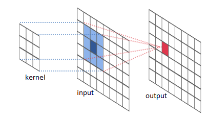
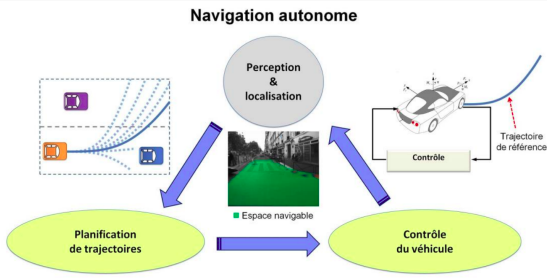

---
jupytext:
  notebook_metadata_filter: rise
  text_representation:
    extension: .md
    format_name: myst
    format_version: 0.13
    jupytext_version: 1.11.5
kernelspec:
  display_name: Python 3 (ipykernel)
  language: python
  name: python3
rise:
  auto_select: first
  autolaunch: false
  centered: false
  controls: false
  enable_chalkboard: true
  height: 100%
  margin: 0
  maxScale: 1
  minScale: 1
  overlay: "<div style='position: absolute; top: 0; left: 0'>Introduction \xE0 la\
    \ Science des Donn\xE9es, L1 Math-Info, Facult\xE9 des Sciences d'Orsay</div><div\
    \ style='position: absolute; top: 0; right: 0'></div>"
  scroll: true
  slideNumber: true
  start_slideshow_at: selected
  transition: none
  width: 90%
---

+++ {"slideshow": {"slide_type": "slide"}}

<center>

# Cours 6: Traitement d'images

</center>

<br>

<center>Fanny Pouyet</center>

<center>L1 Informatique</center>

<center>Janvier - Mai 2022</center>

+++ {"slideshow": {"slide_type": "slide"}}

**Précédemment**

* Chaîne de traitement d'analyse de données
* Application aux images : extraction d'attributs
* Classificateurs

**Cette semaine**

* Préparation des données : traitement d'images

+++ {"slideshow": {"slide_type": "slide"}}

## Mise en contexte

Pour le moment nous avons traité des images «parfaites» pour notre
problème:
- images toutes la même taille, 
- images carrées, 
- fond blanc ou uni (pour le mélanome),
- objet d'étude centré.

+++ {"slideshow": {"slide_type": "slide"}}

Dans la suite du cours et pour votre Projet 2, vous allez étudier des
images imparfaites, que vous aurez peut-être vous même prises:

- tailles variables (résolution, format paysage ou portrait, ...),
- fond «complexe»,
- objet pas forcément centré,
- images volumineuses

+++ {"slideshow": {"slide_type": "fragment"}}

Aujourd'hui nous allons voir comment traiter ces images pour pallier à
ces difficultés. Vous appliquerez ces méthodes lors du
[TP6](2_arcimboldo.md)

+++ {"slideshow": {"slide_type": "slide"}}

## Les grandes étapes du traitement

1. Transformation d'une image en image carrée
2. Extraction de l'objet
3. Recadrage et centrage de l'image
4. Réduction de la résolution

```{code-cell} ipython3
---
slideshow:
  slide_type: slide
---
# Automatically reload code when changes are made
%load_ext autoreload
%autoreload 2
from PIL import Image, ImageDraw, ImageFont
import matplotlib.pyplot as plt
from scipy import signal

from utilities_cours_correction import *
from intro_science_donnees import *
```

+++ {"slideshow": {"slide_type": "slide"}}

Lors de la séance 6 nous allons traiter cette image:

```{code-cell} ipython3
---
slideshow:
  slide_type: fragment
---
img
```

+++ {"slideshow": {"slide_type": "slide"}}

### Transformation en image carrée

Nous allons la transformer en image carrée à l'aide de la fonction crop, qui veut dire rogner en anglais.

```{code-cell} ipython3
---
slideshow:
  slide_type: slide
---
img_carree = img.crop(box=(x_gauche, y_bas, x_droite, y_haut))
img_carree
```

+++ {"slideshow": {"slide_type": "slide"}}

### Extraction de l'objet

Comment extraire le smiley ?

+++ {"slideshow": {"slide_type": "slide"}}

#### Filtre pixel-à-pixel 

On peut regarder chaque pixel et déterminer s'il fait partie de
l'objet ou bien de l'arrière plan. S'il est jaune, il appartient à
l'objet! Pour cela trois étapes:

+++ {"slideshow": {"slide_type": "slide"}}

1.  En TP vous commencerez par construire la fonction
    `yellowness_filter`. Elle renvoie l'intensité de jaune pour chaque
    pixel. En RGB, le jaune $y$ (pour *yellow*) se calcule comme suit:

    $y = r + g -b $

    La formule $r+g-b$ est un produit scalaire $v.w$ entre le vecteur
    $v = (r,g,b)$ et le vecteur $w=(1,1,-1)$.

    Le vecteur $w$ a le coefficient $-1$ pour le canal bleu car le
    jaune n'en a pas.

+++ {"slideshow": {"slide_type": "slide"}}

2.  Puis vous créerez la fonction `color_correlation_filter` qui
    calcule pour chaque pixel d'une image, sa corrélation avec une
    couleur donnée (dans notre exemple le jaune).

+++ {"slideshow": {"slide_type": "fragment"}}

3.  En appliquant un seuil à la sortie de cette fonction vous
    obtiendrez une matrice de booléens : `True` si le pixel appartient
    à l'objet, `False` sinon.

```{code-cell} ipython3
---
slideshow:
  slide_type: fragment
---
plt.imshow(foreground, cmap='gray');
```

+++ {"slideshow": {"slide_type": "slide"}}

### Recadrage

Ensuite on va chercher à réduire la résolution de l'image. On commence
par calculer son barycentre.

**Définition du barycentre :** Le barycentre est le centre de gravité d'un objet.


« Tout corps pesant a un centre de
gravité bien défini en lequel tout le poids du corps peut être
considéré comme concentré. » Archimède.

Par exemple, pour le disque c'est son
centre, pour un triangle l'intersection entre les trois médianes

+++ {"slideshow": {"slide_type": "slide"}}

### Réduction de la résolution

Parfois certaines images sont trop volumineuses et on peut ainsi
vouloir réduire leur résolution.

En TP nous verrons comment passer d'une image 256x256 en 128x128 à
l'aide de différentes méthodes d'anti-crénelage: le
sous-échantillonage et le lissage par convolution.

+++ {"slideshow": {"slide_type": "slide"}}

#### Anti-crénelage par sous-échantillonage

Lorsque la résolution d'une image est trop faible, les contours lisses
d'un objet sont remplacés par des «escaliers».

```{code-cell} ipython3
plt.figure(figsize=(12,12)) 
plt.subplot(1,3,1)    
plt.imshow(resolution256x256)
plt.title("Résolution 256x256", fontsize=18) 
plt.subplot(1,3,2)    
plt.imshow(resolution64x64)
plt.title("Résolution 64x64", fontsize=18) 
plt.subplot(1,3,3)    
plt.imshow(resolution8x8)
plt.title("Résolution 8x8", fontsize=18) 
```

+++ {"slideshow": {"slide_type": "slide"}}

**Solution pour lisser ?** 
* On peut échantillonner la couleur des pixels à la limite des zones distinctes (l'objet et l'arrière plan par exemple) 
* puis on remplace ces pixels par le pixel "moyen" de ses voisins. L'image sera plus floue mais ne présentera plus cet aspect d'escalier.

```{code-cell} ipython3
plt.figure(figsize=(12,12)) 
plt.subplot(1,3,1)    
plt.imshow(resolution256x256)
plt.title("Résolution 256x256 ", fontsize=18) 
plt.subplot(1,3,2)    
plt.imshow(resolution64x64_lisse)
plt.title("Résolution 64x64 lissé", fontsize=18) 
plt.subplot(1,3,3)    
plt.imshow(resolution8x8_lisse)
plt.title("Résolution 8x8 lissé", fontsize=18) 
```

+++ {"slideshow": {"slide_type": "slide"}}

### Lissage par convolution

**Convolution d'images :** En traitement d'images, une matrice de
convolution ou noyau est une petite matrice utilisée pour le floutage,
l'amélioration de la netteté de l'image, le gaufrage, la détection de
contours, et d'autres. Tout cela est accompli en faisant une
convolution entre le noyau et l'image (source: wikipédia).

<center> 
http://mathinfo.alwaysdata.net/2016/11/filtres-de-convolution/</center>

+++ {"slideshow": {"slide_type": "slide"}}

Chaque pixel de la nouvelle image est obtenu en multipliant le pixel
d'origine et ses voisins par des coefficients (poids ou *weight*)
donnés par une matrice appelée le noyau (*kernel*).  A chaque niveau de la pyramide, on diminue la taille de l'image et donc la résolution.

<center> 
Source: wikimedia</center>

+++ {"slideshow": {"slide_type": "slide"}}

Il existe une multitude de noyaux. Nous en verrons 2 en TP:

    * un noyau $3\times3$ : le pixel d'origine et ses huit voisins 
    * la pyramide de Gauss : les poids correspondent à une moyenne discretisée de la fonction normale (en fait, une fonction binomiale cf. le théorème central limite)

```{code-cell} ipython3
---
slideshow:
  slide_type: '-'
---
ker
```

+++ {"slideshow": {"slide_type": "slide"}}

La convolution consiste à filtrer nos données et à étudier le résultat. 

Mathématiquement, le résultat correspond au produit de convolution de la fonction rouge sur la fonction bleue. C'est l'intégrale (l'aire jaune) en chaque point de la fonction bleue quand on lui applique la rouge.
<center> 
Source : wikimedia</center>

```{code-cell} ipython3
---
slideshow:
  slide_type: slide
---
# l'objet foreground_cropped_clean sera créé en TP
plt.imshow(foreground_cropped_clean, cmap='gray');
```

+++ {"slideshow": {"slide_type": "slide"}}

**Traitement au bord :** Comment faire pour les pixels aux bords ?

* *Enroullage (Wrap)* : Les valeurs sont récupérées des bords opposés.
* *Extension* : Le pixel le plus près du bord est dupliqué pour donner
  des valeurs à la convolution.
* *Miroir* : L'image est reflétée sur les bords. 
* *Crop* : Tout pixel demandant l'utilisation de pixel en dehors de
  l'image n'est pas utilisé

+++ {"slideshow": {"slide_type": "slide"}}

### Extraction de l'objet

On peut maintenant extraire uniquement l'objet

```{code-cell} ipython3
---
slideshow:
  slide_type: '-'
---
smiley = transparent_background_filter(img_crop, foreground_cropped_clean)
smiley
```

+++ {"slideshow": {"slide_type": "slide"}}

### Conclusion intermédiaire

À cette étape, nous avons:
- cadré;
- filtré le jaune et identifié l'image;
- recadré et centré l'image; 
- diminué la résolution et lissé;
- extrait l'image

```{code-cell} ipython3
---
slideshow:
  slide_type: fragment
---
image_grid(images)
```

+++ {"slideshow": {"slide_type": "slide"}}

### Extraction des contours

Comment feriez vous pour extraire les contours de l'objet ?

+++ {"slideshow": {"slide_type": "fragment"}}

Ici, on va calculer la différence entre chaque pixel et son voisin de
gauche (c'est aussi de la convolution !).
* S'ils sont tous les deux en arrière-plan ou bien dans l'objet alors
  la différence est 0.
* Sinon, la différence est -1 ou 1, et alors on est sur le contour.

Pour ce calcul, on perd une bande de 1 pixel en largeur; pour
conserver l'image carrée, on supprimera aussi une bande de 1 pixel en
hauteur.

```{code-cell} ipython3
---
slideshow:
  slide_type: slide
---
# M est la matrice de booléens obtenue après lissage
# M[:-1, 1:] : on enlève la dernière ligne et la première colonne
# M[:-1, 0:-1] : on enlève la dernière ligne et la dernière colonne

contour_horizontal = np.abs(M[:-1, 1:] - M[:-1, 0:-1])
plt.imshow(contour_horizontal, cmap='gray');
```

+++ {"slideshow": {"slide_type": "slide"}}

### Superposition d'images

Superposer deux images revient a remplacer les pixels d'une image par
ceux d'une autre image. Remplacons ici, un oeil par une banane.

Prenons une image de banane des TP précédents. Cette image fait 32x32
pixels, ce qui est beaucoup plus petit que notre smiley qui fait
256x256! Dans le cas inverse nous devrions réduire la résolution avant
l'incorporation.

```{code-cell} ipython3
---
slideshow:
  slide_type: slide
---
banana = fruits[19]
M = np.array(smiley)
B = np.array(banana)
i = 106
j = 100
P = M[i:i+32, j:j+32]
F = foreground_filter(banana)
P[F] = B[F]
M[i:i+32, j:j+32] = P
j = 136
M[i:i+32, j:j+32] = P


plt.imshow(M);
```

+++ {"slideshow": {"slide_type": "slide"}}

### Réalisation d'une animation

En fin de TP, vous assemblerez toutes ces images pour faire une
mini-vidéo!

- Les première vidéos faisaient 16/24 fps (*frames per second*; images
  par seconde).
- Aujourd'hui à la TV on est en moyenne à 60 fps.
- En fait, 30 fps est un ordre de grandeur confortable.
- En TP, nous ferons une vidéo faisant 2 fps (on n'a qu'une dizaine
  d'images).

+++ {"slideshow": {"slide_type": "slide"}}

## Remarques conclusives et domaine de la vision par ordinateur

+++ {"slideshow": {"slide_type": "-"}}

Aujourd'hui nous avons vu comment traiter des images :
- cadrage et centrage;
- filtrage;
- changement de résolution par convolution;
- extraction de l'image et manipulation;
- superposition d'images;
- animations.

+++ {"slideshow": {"slide_type": "slide"}}

Ces manipulations peuvent aller beaucoup plus loin; c'est le domaine
de recherche de la [vision par ordinateur](https://fr.wikipedia.org/wiki/Vision_par_ordinateur)
(*computer vision*). Elle vise à:

- reconnaître des image
- les comprendre
- traiter les informations qui en découlent

Un des objectifs de ce domaine est de comprendre et reproduire l'oeil
humain, et plus généralement le système visuel humain. Connaissez vous
des exemples d'applications de ce domaine ?

+++ {"slideshow": {"slide_type": "slide"}}

* **Mouvements et reconnaissance d'activités**

[](https://youtu.be/JACG9u1KtxA "Chalearn Looking at People Challenge 2014")

+++ {"slideshow": {"slide_type": "slide"}}

* **Voitures autonomes**

    Identification des piétons et planification de leur intention
    <center> 
    http://wider-challenge.org/img/2019/portfolio/pedestrian.jpeg</center>

+++ {"slideshow": {"slide_type": "slide"}}

<center> 
Source : Thèse de Marin Toromanoff, Septembre 2021, tel-03347567</center>

+++ {"slideshow": {"slide_type": "slide"}}

*  **Biomédical**

    Classification de grains de beauté, analyses d'imagerie médiale
    (IRM, scanners etc), reconnaissance d'espèces de bactéries

```{code-cell} ipython3
---
slideshow:
  slide_type: '-'
---
dataset_dir = os.path.join(data.dir, 'Melanoma')
gdb = load_images(dataset_dir, "*.jpg")
image_grid(gdb, titles=gdb.index)
```

+++ {"slideshow": {"slide_type": "slide"}}

*  **Météorologie**

    Surveillance d'ouragans, cyclones, tsunamis, ...

* **Art**

    https://deepart.io/

+++ {"slideshow": {"slide_type": "slide"}}

## Perspectives

*  **CM7**
   * Biais dans les données et notion de métadonnées

*  **CM8**
   * La classification d'images en 2022: RCNN

*  **CM9**
   * Éthique et déontologie de l'IA

*  **TP6**
   * Traitement d'images (en vue du projet 2)
   * Rendu obligatoire **avant Lundi 14 mars 22h**.
