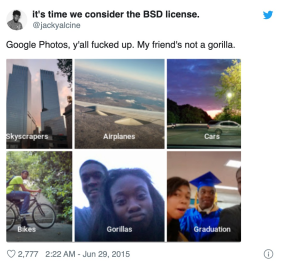
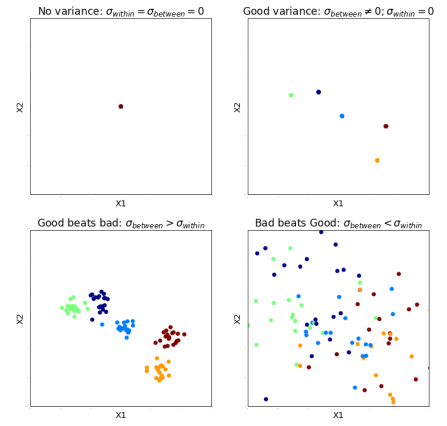
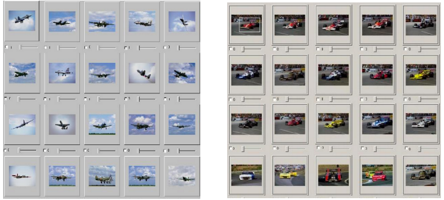
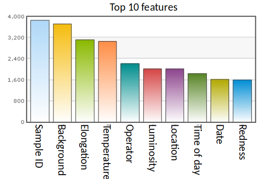
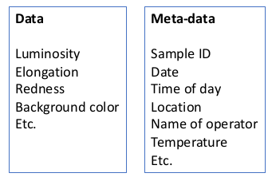

---
jupytext:
  notebook_metadata_filter: rise
  text_representation:
    extension: .md
    format_name: myst
    format_version: 0.13
    jupytext_version: 1.11.5
kernelspec:
  display_name: Python 3 (ipykernel)
  language: python
  name: python3
rise:
  auto_select: first
  autolaunch: false
  centered: false
  controls: false
  enable_chalkboard: true
  height: 100%
  margin: 0
  maxScale: 1
  minScale: 1
  overlay: "<div style='position: absolute; top: 0; left: 0'>Introduction \xE0 la\
    \ Science des Donn\xE9es, L1 Math-Info, Facult\xE9 des Sciences d'Orsay</div><div\
    \ style='position: absolute; top: 0; right: 0'></div>"
  scroll: true
  slideNumber: true
  start_slideshow_at: selected
  transition: none
  width: 90%
---

+++ {"slideshow": {"slide_type": "slide"}}

<center>

# Cours 6: Biais dans les données : analyse des métadonnées

</center>

<br>

<center>Fanny Pouyet</center>

<center>L1 Informatique</center>

<center>Janvier - Mai 2022</center>

+++ {"slideshow": {"slide_type": "slide"}}

**Précédemment**

* Chaine de traitement d'analyse de données
* Application aux images : extraction de features
* Classificateurs
* Préparation des données : traitement d'images

**Cette semaine**

* Biais dans les données : utilisation de métadonnées

+++ {"slideshow": {"slide_type": "slide"}}

## Introduction : les bonnes versus les mauvaises données

### Big data

[Peter Norvig](https://fr.wikipedia.org/wiki/Peter_Norvig), directeur de recherche chez Google a dit en 2011:

"We don’t have better algorithms, we just have more data."

A cette époque, on pensait que les méthodes d'IA pourraient résoudre tous les problèmes s'ils avaient suffisamment de données (les *big data*).

+++ {"slideshow": {"slide_type": "slide"}}

Etes-vous capable de remettre en cause cette assertion : qu'est ce qui pose problème ?

+++ {"slideshow": {"slide_type": "fragment"}}

Cette idée simpliste à mener à des défaillances graves d'algorithmes prenant des décisions racistes (exemple) ou sexistes.

<center> Source: twitter en 2015</center>

+++ {"slideshow": {"slide_type": "slide"}}

### Good data

[Peter Norvig] a repris sa citation et ajouté cette nuance indispensable :

“More data beats clever algorithms, but better data beats more data.”

Pour l'exemple raciste ci-dessus, l'algorithme n'avait été entrainé qu'à reconnaitre des humains caucasiens ("blancs"), ratant une large diversité humaine.

Les bonnes données d'entrainement doivent donc contenir une diversité représentative des données existantes.

+++ {"slideshow": {"slide_type": "slide"}}

Pour le jeu de données pommes/bananes : 
* Si on a 1 000 000 de photos de pommes et qu'elles sont toutes rouges, on croira que les golden (pommes jaunes) sont des bananes...
* Il vaut mieux 1 000 photos variables que 1 000 000 de photos identiques ou presque identiques

+++ {"slideshow": {"slide_type": "slide"}}

### Variance des données

<center> </center>

Le meilleur cas correspond au cas où la variance intra-groupe est plus faible que la variance inter-groupe. On sera capable de regrouper les données (notion de *clustering*)  selon certaines caractéristiques.

+++ {"slideshow": {"slide_type": "slide"}}

### Hypothèse "classique" en apprentissage statistique

Les données sont indépendantes et distribuées indentiquement (*Data are i.i.d.: identically and independently distributed*):
* elles ont été obtenues aléatoirement dans des conditions identiques (comment connaitre les conditions ? on verra ca juste après!)
* en pratique, on mélange les données puis on créé un jeu d'entrainement et un de test

+++ {"slideshow": {"slide_type": "slide"}}

## Biais dans les données

* Qu'est ce que c'est ?
* Peut-on identifier des biais ?
* Commentles corriger ?

+++ {"slideshow": {"slide_type": "slide"}}

### Définition

En statistique, un biais engendre des erreurs systématiques qui font que les résultats d'une étude sont faussés. Cela pose problème lorsque les conclusions sont différentes de la vérité (Last, 2001)

Mathématiquement pour un paramètre, le biais d'un estimateur est la différence entre la moyenne de l'estimateur (qui est une variable aléatoire, voir [CM2](../Semaine2/CM2.md)) et la valeur du paramètre (valeur fixe).

+++ {"slideshow": {"slide_type": "slide"}}

Il existe une multitude de biais comme par exemple:

* **biais d'échantillonnage ou de sélection** : les personnes sondées ne sont pas représentatives de la population (sondages en amont des élections)
* **biais de mesure** : les techniques de mesures sont incorrectes.
* **biais de confirmation** : les données sont partagées lorsqu'elles confirment les *a priori* des auteurs ou autrices de l'étude 
* **biais d’attrition** : retrait de certains patients de l’analyse (classique en médecine)
* **biais d’évaluation** : lorsque la mesure du critère de jugement n'est pas réalisée de la même manière dans les deux groupes de patients (on vérifie que les correcteurs et correctrices ont une même moyenne et variance)

Il faut faire attention à ne pas introduire un biais systématique dans les données d'entrainement.

+++ {"slideshow": {"slide_type": "slide"}}

A noter, il y a deux sources pour chacun des biais sus-mentionnés:
  
  * soit le biais provient des participants/données intrinsèques  
  * soit de la personne effectuant les recherches 
  
*exemple du biais d'échantillonnage : les personnes sondées ne sont pas représentatives de la population * : soit les personnes ne répondent pas (biais provenant des participants) soit les personnes invitées à répondre ne représentent pas la population générale (biais provenant de la chercheuse ou du chercheur)

+++ {"slideshow": {"slide_type": "slide"}}

### Exemples

### Biais d'échantillonnage

Cas pratique: lors de la seconde guerre mondiale, on analyse les impacts de balles sur les avions anglais touchés par des tirs nazis.

Ou doit-on renforcer la coque des avions ?

https://miro.medium.com/max/700/0*pOUktcJQlQ7t9r1S.jpg

+++ {"slideshow": {"slide_type": "fragment"}}

Le biais d'échantillonnage vient du fait qu'on n'analyse que les avions qui sont revenus à la base et donc qui ont continué à voler. Il faut renforcer là ou il n'y a pas d'impacts de balles !!

+++ {"slideshow": {"slide_type": "slide"}}

On ne prend que des pommes rouges alors qu'il existe des pommes jaunes (par ex. les golden) ou vertes (par ex. les granny smith).

```{code-cell} ipython3
---
slideshow:
  slide_type: '-'
---
# Automatically reload code when changes are made
%load_ext autoreload
%autoreload 2
import os
from PIL import Image, ImageDraw, ImageFont
import matplotlib.pyplot as plt
from scipy import signal
import seaborn as sns
from intro_science_donnees import *
from utilities import *

dataset_dir = os.path.join(data.dir, 'ApplesAndBananas')

images = load_images(dataset_dir, "*.png")
redapples = [crop_image(img) for img in images[[114,115,116,118,122,124,125,133,134,135]]]
image_grid(redapples)
```

+++ {"slideshow": {"slide_type": "slide"}}

On ne pourra pas généraliser: ce serait risqué de considérer la couleur comme un attribut adéquat.

```{code-cell} ipython3
---
slideshow:
  slide_type: '-'
---
couleur = [crop_image(img) for img in images[[100,101,102,103,104,114,115,116,118,122,369,370,374,375,377]]]

image_grid(couleur)
```

+++ {"slideshow": {"slide_type": "slide"}}

### Biais d'évaluation ou biais confondant

**Paradoxe de Simpson** : on a une mauvaise corrélation entre deux variables, car on ne controle pas pour une troisième variable qui provoque la confusion.

<center> </center>

+++ {"slideshow": {"slide_type": "slide"}}

Pour classifier des images on peut par exemple mesurer les éléments dans des contextes différents. Le contexte peut alors etre confondu avec l'élément lui-même.
On ne pourra pas généraliser, si le contexte change on ne saura pas s'adapter.

*exemple :* Les photos d'avions dans le ciel versus de voitures sur goudron. Comment classerait-on un avion au sol ?
<center> </center>

+++ {"slideshow": {"slide_type": "slide"}}

### Biais de mesure

Par exemple, si on ne prend que des bananes photographies horizontalement dans le jeu de données d'entrainement, on ne pourra pas généraliser car on risque de croire que l'orientation est une information utile pour discriminer les pommes des bananes.

```{code-cell} ipython3
---
slideshow:
  slide_type: '-'
---
bananas_h = [crop_image(img) for img in images[[369,370,374,375,377,379, 387,396,401,406]]]
image_grid(bananas_h)
```

+++ {"slideshow": {"slide_type": "slide"}}

## Correction des biais

Comment pallier ces problèmes ? 
* en évitant les biais
* en identifiant les biais

+++ {"slideshow": {"slide_type": "slide"}}

### Eviter les biais

* Le protocole de collecte des données doit être décrit explicitement
* En parler avec d'autres personnes, identifient-elles d'autres biais potentiels ? Y a t il des remarques sur le protocole ?

+++ {"slideshow": {"slide_type": "slide"}}

* En médecine, on fait généralement des essais contrôlés randomisés (en double-aveugle idéalement) : 

<center> </center>

+++ {"slideshow": {"slide_type": "slide"}}

### Identifier les biais

* Lors de la génération des données
    * donner des noms explicites aux attributs
    * récupérer le plus de métadonnées possibles (définition ci après)
* en cherchant des incohérences ou des performances suspectes
    * estimer les performances des ensembles d'entrainement et de test séparément
    * comparer les performances faites à partir des données versus à partir des métadonnées *uniquement*

+++ {"slideshow": {"slide_type": "slide"}}

Qu'entend-t-on pas "comparer les performances des données versus des métadonnées" ?

On peut comparer les performances d'un classificateur qui a pour données d'entrée:
*  les images
*  les métadonnées

Si le classificateur est meilleur avec les métadonnées qu'avec les images alors il existe un biais.
*exemple* : pouvez vous identifier le problème ici ?

<center> </center>

+++ {"slideshow": {"slide_type": "slide"}}

## Métadonnées

Ce sont les informations disponibles sur nos données. Le terme métadonnée (*metadata*) est apparu dans les année 90 avec l'essor d'Internet et la nécessité d'en décrire les ressources.


<center> </center>

+++ {"slideshow": {"slide_type": "slide"}}

### Utilisation des métadonnées

Les métadonnées concernent tous les secteurs de l'économie qui gèrent des ressources documentaires sous forme électronique, c'est à dire *tous* les secteurs de l'économie

* Universités,
* Administrations,
* Entreprises,
* Médiathèques , etc.

+++ {"slideshow": {"slide_type": "slide"}}

### Corriger les biais grâce aux métadonnées

Pour corriger les biais, on propose de créer un "modèle causal" c'est-à-dire d'écrire les liens de causes à effets entre les métadonnées et les données.

Le modèle causal le plus simple est de la forme : X --> Y (si j'ai X alors j'ai Y /  X implique Y).

+++ {"slideshow": {"slide_type": "slide"}}

**Exercice :** Construisons ensemble le modèle causal des pommes et des bananes (au tableau)

```{code-cell} ipython3
---
slideshow:
  slide_type: '-'
---
variabilite = images[[1,10,104,40,118,255,369,375,377,490]]

image_grid(variabilite)
```

+++ {"slideshow": {"slide_type": "slide"}}

* Objectif: identifier les potentiels biais (d'échantillonnage, de mesure, d'effets confondants ...)

* Métadonnées : localisation, date et heure
* Données : des photos de pommes et de bananes
    * même arrière-plan ? 
* Expérimentatrice ou expérimentateur : photographe

```{raw-cell}
---
slideshow:
  slide_type: skip
---
Solution : 


localisation = effets confondants ?
     |                      |
     v                      v
 objet = fruit         arrière-plan = effets confondants ?
      |    |             |
      |    v             v
      |      photographie
      |           ^
      v           |
photographe = expérimentateur ou expérimentatrice
           = biais de sélection (fleche de gauche) ?
           = biais de mesure (flèche de droite) ?
```

+++ {"slideshow": {"slide_type": "slide"}}

## Conclusions

* Il existe de nombreux types de biais :

    * biais = tout facteur affectant les données dont l'effet ne peut pas être diminué en ajoutant plus de données
    * Plus large n'est pas forcément mieux
    
    
* Pour éviter les biais:

    * Planifiez et faites relire votre protocole
    * Enregistrez et analysez vos métadonnées (exemple = date, lieu, opérateur)
    
    
* Soyez **systématique, organisé et critique** de vos résultats

+++ {"slideshow": {"slide_type": "slide"}}

## Perspectives

* **CM8**
    * Retour sur les méthodes pour classifier des images en 2022
    * Autres élements à classifier

* **Projet 2**
    * Début du projet 2 
    * Rendu obligatoire chaque semaine **avant Lundi 22h**
    * **On corrigera le contenu de la version déposée en Semaine 9 avant lundi 11 avril 22h sur GitLab**

* **QUIZ 2**
    * Mêmes modalités que le quiz précédent
    * A faire avant le prochain cours : **mercredi 30 mars 10h45** (la semaine prochaine il n'y a pas cours pour cause du jeudi de l'ascension)
