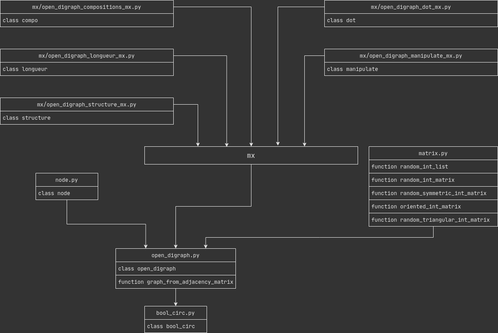
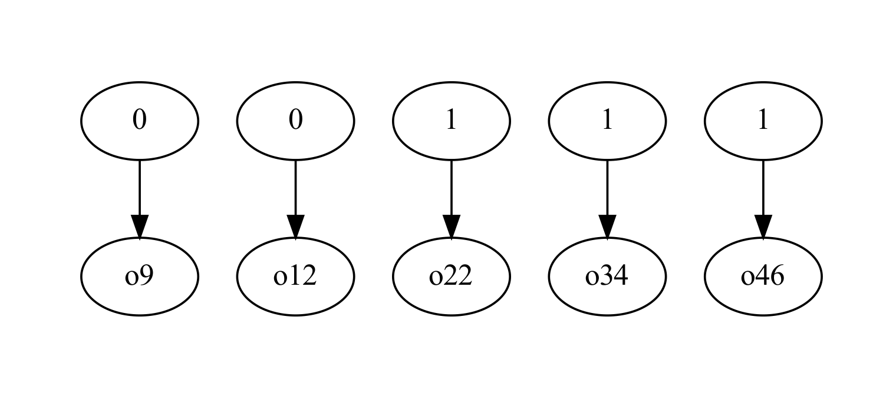
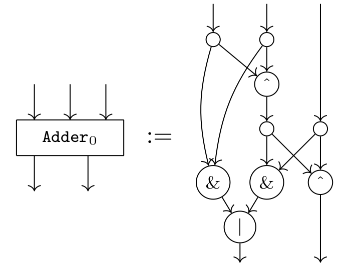
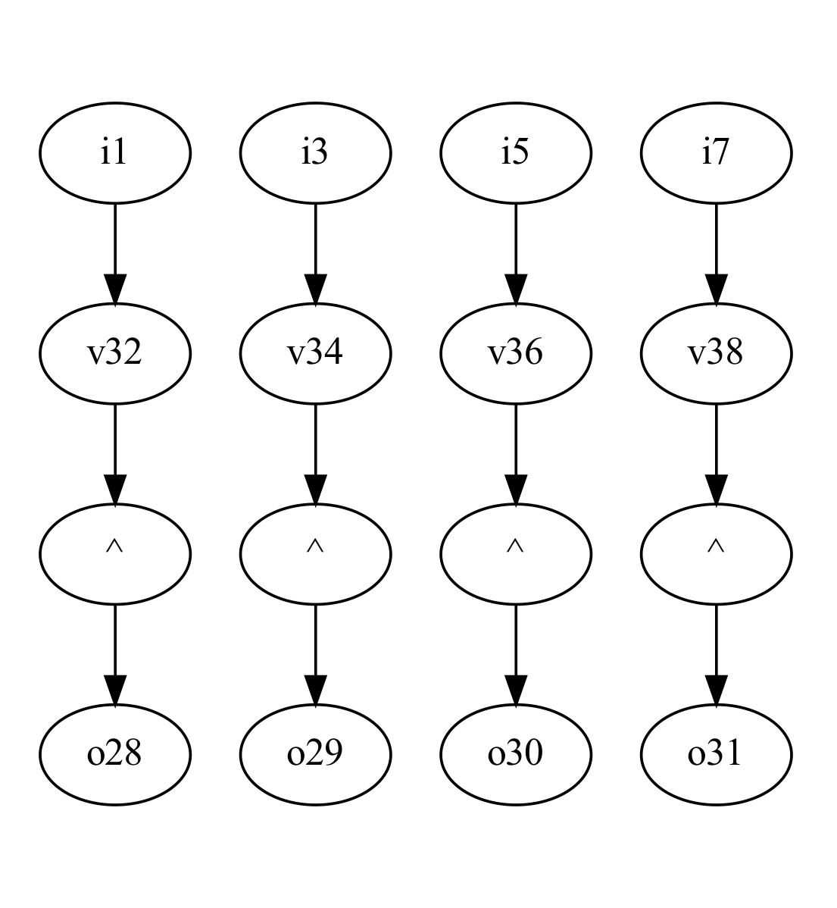
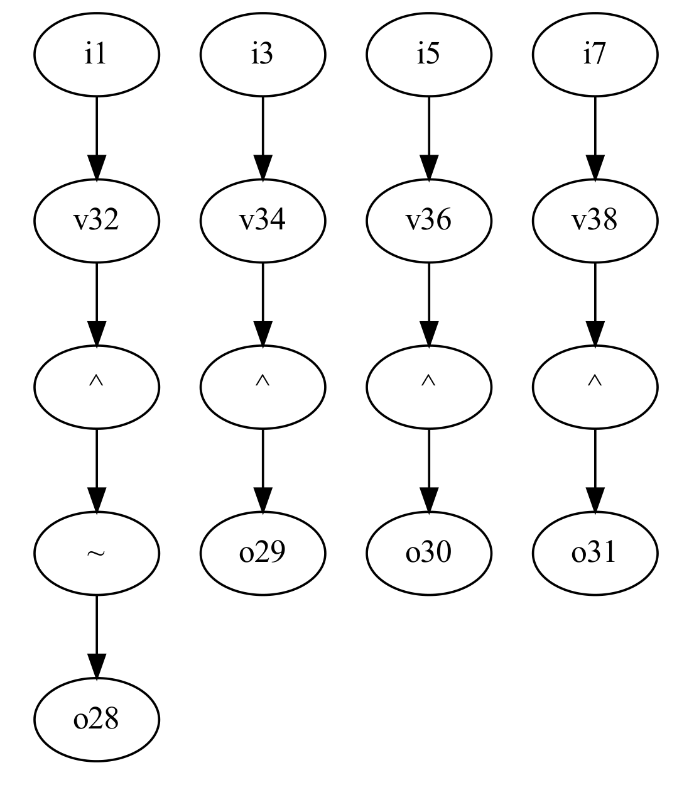

# Projet Informatique: Rapport


## Réponses aux questions


### Point 1

### Point 2


```python
def test_evaluate(self):
   # former le adder
   bc = bool_circ.half_adder(3)
  
   self.assertTrue(bc.is_well_formed())


   # initialiser les input
   inp1 = bool_circ.fromint(4, regsize=4)
   inp2 = bool_circ.fromint(3, regsize=4)


   # fusionner les deux chiffres en un meme circuit
   inp = inp1.parallel(inp2)


   # brancher ce circuit inp en entree du adder
   a_evaluer = bc.compose(inp)


   # evaluer ce circuit successivment jusqu'a obtenir l'output (4 noeuds)
   a_evaluer.evaluate()


   # afficher le graphe simplifier -> contient 4+3 en binaire
   a_evaluer.display()


```



### Point 3



La profondeur d'un half adder de registres de taille `n` est `3x2^n+3`.


Le nombre de portes d'un half adder de registres de taille `n` est `5x2^n`.


Voir les fichiers [adder(0)](tests/d0_prof.pdf), [adder(1)](tests/d1_prof.pdf),
[adder(2)](tests/d2_prof.pdf) et [adder(3)](tests/d3_prof.pdf) qui épaulent cette conjecture.


Le chemin le plus court d'une entrée vers une sortie est de longueur 4: c'est les input en tête de registre
qui sont connectés à un seul adder 0, et qui sont donc a distance `1 + plusCourtCheminVersOutput(adder0) + 1`
soit 4.


### Point 4
En premier lieu nous avons vérifié l'identité :
pour cela il suffit simplement de composer dec et enc, puis de réécrire.
```python
def test_reecrit(self):
   enc = bool_circ.enc()
   dec = bool_circ.dec()
   identite___esperons = dec.compose(enc)
   identite___esperons.reecrit()
   identite___esperons.display()
```


Nous avons eu quelques bugs, notamment la fonction de copie de circuit et
la fonction de composition mais ces problèmes ont été résolus.


Nous avons ensuite exécuté "reecrit" sur ce circuit ainsi obtenu,
et nous avons obtenu le circuit que voici :





<br>


On constate qu'il s'agit bien de l'identité même si (input)->(xor) n'a pas été simplifié
(pas dans les règles de réécriture, on pourrait le rajouter si on le souhaite).


Concernant la vérification des erreur, il suffit simplement de rajouter un not (~)
juste avant un des output de enc avant de composer.


```python
def test_erreur(self):
   enc = bool_circ.enc()
   dec = bool_circ.dec()


   # ajout du premier tilde -- ne casse pas -- equivalent a l'identite
   id_output_quelconque = enc.outputs[0]
   node_output_quelconque = enc.get_node_by_id(id_output_quelconque)
   parent = list(node_output_quelconque.get_parents_ids())[0]
   enc.remove_edge(parent, id_output_quelconque)
   node_tilde_extra = enc.add_node("~")
   enc.add_edge(parent, node_tilde_extra)
   enc.add_edge(node_tilde_extra, id_output_quelconque)


   identite___esperons = dec.compose(enc)
   identite___esperons.reecrit()
   identite___esperons.display()
```


De la même manière on peut vérifier qu'après réécriture,
si on introduit 2 erreurs ça ne donne pas l'identité.


```python
def test_erreur(self):
   enc = bool_circ.enc()
   dec = bool_circ.dec()


   # ajout du premier tilde -- ne casse pas -- equivalent a l'identite
   id_output_quelconque = enc.outputs[0]
   node_output_quelconque = enc.get_node_by_id(id_output_quelconque)
   parent = list(node_output_quelconque.get_parents_ids())[0]
   enc.remove_edge(parent, id_output_quelconque)
   node_tilde_extra = enc.add_node("~")
   enc.add_edge(parent, node_tilde_extra)
   enc.add_edge(node_tilde_extra, id_output_quelconque)


   # ajout du second tilde -- casse , non equivalent a l'identite
   id_output_quelconque = enc.outputs[1]
   node_output_quelconque = enc.get_node_by_id(id_output_quelconque)
   parent = list(node_output_quelconque.get_parents_ids())[0]
   enc.remove_edge(parent, id_output_quelconque)
   node_tilde_extra = enc.add_node("~")
   enc.add_edge(parent, node_tilde_extra)
   enc.add_edge(node_tilde_extra, id_output_quelconque)


   identite___esperons = dec.compose(enc)
   identite___esperons.reecrit()
   identite___esperons.display()
```



Pendant le debuggage nous avons pu mettre en place un système d'affichage de l'état du graphe lorsque réécrit s'occupe d'un nœud particulier (avec arrêt d'exécution grâce à input()).
Cela à été plus que pratique pour tester les différents cas de réécriture"


## Descriptif


### Test
Nous nous sommes assurés d'écrire des tests pour chaque fonctionnalité
afin de s'assurer de son bon fonctionnement.


### Evaluate
Evaluate a été légèrement modifié par rapport aux indications fournies dans les feuilles de TP, dans la mesure où il s'arrête non pas seulement quand les cofeuilles sont immédiatement reliées à des output, mais vérifie aussi que ces cofeuilles sont bien des 0 ou des 1


En effet il ne faut pas arrêter la simplification lorsqu'on est dans un cas (opérateur)->(output), il faut encore s'occuper des éléments neutres


### Réécrit


Réécrit lui n'a pas été modifié dans la mesure où le résultat reste assez évocateur pour être compris dans le cas des codes de hamming.


Nous avons remarqué que le résultat pouvait finir dans un format (input)->(opérateur binaire à qui on a fourni 1 seul parent)->(output)


La règle (input)->(^) <=> (input)-> n'étant pas spécifiée, nous avons fait le choix de ne pas l'implémenter pour les raisons évoqués plus haut.


### Parse parentheses


Parse parenthèses ne fonctionne malheureusement pas comme nous le souhaitions, il passe correctement les tests fournis dans les feuilles mais en utilisation pratique pour enc() et dec() il a été impossible de produire le résultat attendu.

