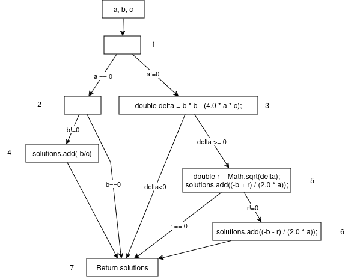
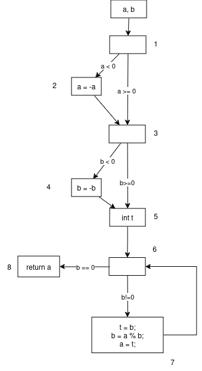

# Note : 14/20
*Nom, Prénom* : Thieffry Raphaël 

# Exercice 1
## Question１

## Question 2
Il suffit d'avoir un cas de test qui emprunte la branche de gauche, tandis
qu'un autre emprunte la branche de droite.
L'analyse avec l'outil coverage d'intelij montre que les cas de test passent pour chaque instruction de la mathode.
## Question 3
La couverture d'arc n'est en effet pas gérée. 
Il faut rajouter 3 cas de test pour couvrir ces branches inexplorées.
## Question 4
Il me semble que pour cette fonction, couverture d'arc <=> couverture de chemins.
En effet, ici les chemins primaires ici sont les chemins qui vont du début à la fin
du graphe de flot de controle.

# Exercice 2
## Question 1

## Question 2
C'est bon
## Question 3
(1, 2, 3, 4, 5, 6, 8)
Il s'agit du plus long chemin primaire, et par consequent du plus long chemin simple.
Ainsi, le plus long chemin simple ici est de 7.
Pour ce qui est de les lister, c'est bien trop long.
Il faudrait énumérer les sous-chemins des chemins primaires.
On se contentera donc de lister les chemins primaires.
## Question 4
(1, 2, 3, 4, 5, 6, 8),  
(1, 3, 4, 5, 6, 8),  
(1, 2, 3, 5, 6, 8),  
(1, 3, 5, 6, 8),  
(1, 2, 3, 4, 5, 6, 7),  
(1, 3, 4, 5, 6, 7),  
(1, 2, 3, 5, 6, 7),  
(1, 3, 5, 6, 7),  
(6, 7, 6),  
(7, 6, 7),  
(7, 6, 8),  

## Question 5

Les cas de test ne couvrent pas tout. Il faut rajouter au moins 8 cas de test à priori.  
On a également deux chemins dont on sait qu'on ne pourra jamais les couvir : 
En effet, si on passe par 4 on sait alors que b>0 après ce bloc, et donc que b!=0 et on sera amené à faire un tour de boucle. 
Ces cas sont explicité dans les fichiers de test dans ./src/test/java

